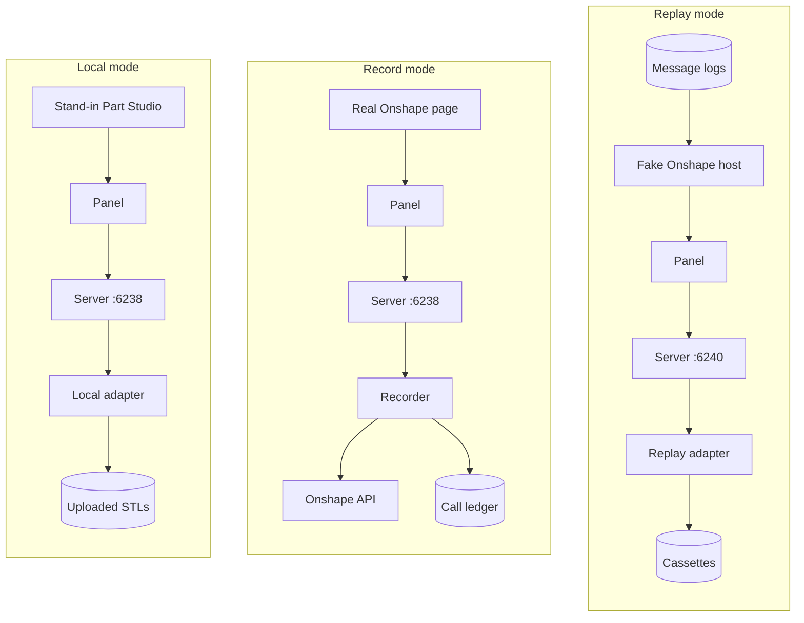

# Print path: restart notes

Written Sun 10-11 around 11:00 PT, when work on the print path paused after the owner tried
local mode. All times are Pacific. This is the one place to restart from: section 1 says
where things stand, section 2 gets a running system back, sections 3 and 4 say what exists
and what was guessed, and section 6 is the next work, built from the owner's feedback of
Sun 10-11.

## 1. Short answer

- **Milestone 1 of the [print roadmap](../plans/2026-10-09-print-roadmap.md) is built and
  reviewed, plus local mode.** The test bed, the print path's Onshape features (Parts,
  Layout, Setup, Preview steps, profiles, print events) and local mode are on the local
  branch `feature/onshape-test-bed` in PenguinCAM: 58 commits, not pushed, no pull request.
- **Nothing has run against real Onshape yet.** Every undocumented Onshape behaviour waits
  on the validation run, which needs the owner's credentials (section 7).
- **Local mode works end to end**: drop any STL file into a stand-in Part Studio, and the
  real panel slices it with Orca and downloads the `.gcode.3mf`. The owner tried it on
  Sun 10-11 and wants it kept as a supported way to use the print path without Onshape.
- **The owner's feedback** asks for an advanced mode, assembly import, a 3D Layout step, a
  layer preview, better slicing progress, cancellation, and answers on two problems seen in
  local mode: the `-100` "no flat face on the plate" error and plate limits hit early with
  organic shapes (section 6; the investigation is section 5). The owner also asked for an
  error-path test campaign (section 6.10) and confirmed the 3D Layout step's design.
- **The investigation found both causes (section 5).** The `-100` failures came from one
  broken STL sliced with supports off, and the print path's sentence for `-100` is wrong (a
  bug). The early limit was the plate triangle cap, which measures the wrong thing: Orca's
  memory follows part volume and copies, not triangles.
- **First thing on restart:** read section 5, start local mode (section 2), then settle the
  open questions in section 6 with the owner before writing a design spec for the next work.

## Contents

1. [Short answer](#1-short-answer)
2. [How to restart](#2-how-to-restart)
3. [What was built](#3-what-was-built)
4. [Decisions, guesses and limitations to revisit](#4-decisions-guesses-and-limitations-to-revisit)
5. [Investigation of the errors seen in local mode](#5-investigation-of-the-errors-seen-in-local-mode)
6. [Next work](#6-next-work)
7. [Still open from the milestone 1 build](#7-still-open-from-the-milestone-1-build)
8. [Order of work, by risk](#8-order-of-work-by-risk)

### Terms

Each term means one thing everywhere below. The terms of the
[milestone 1 build report](2026-10-09-onshape-test-bed-and-milestone-1-build.md#1-terms)
(cassette, message log, scenario, call ledger, counted call, drift report, page id, part,
copy, plate, part store) hold here too.

| Term | Meaning |
|---|---|
| **print path** | PenguinCAM's 3D printing feature: the print page, its server routes and Orca. |
| **panel** | The print page as it runs inside Onshape's right panel (or a stand-in for it). |
| **Setup step, Parts step, Layout step, Preview step** | The print page's four steps, in that order. Slicing starts when the student enters the Preview step. |
| **test bed** | Everything under `testbed/` that lets the print path run without real Onshape. It has three modes. |
| **replay mode** | `PENGUINCAM_TESTBED=replay`: every Onshape request is answered from cassettes; nothing leaves the machine. |
| **record mode** | `PENGUINCAM_TESTBED=record`: requests go to real Onshape and are saved as cassettes and message logs. |
| **local mode** | `PENGUINCAM_TESTBED=local`: every Onshape request is answered from STL files uploaded to the stand-in Part Studio. |
| **stand-in Part Studio** | The page at `/testbed/local` that imitates an Onshape Part Studio around the real panel. |
| **fake Onshape host** | The replay-mode page that embeds the panel the way Onshape does and plays Onshape's side of the messages from message logs. |
| **validation run** | The one recorded session with the owner against real Onshape that completes milestone 1. |
| **advanced mode** | The proposed full-pane view with every slicing setting (section 6.2). |
| **assembly import** | The proposed one-button import of an assembly's parts with their counts (section 6.3). |
| **layer preview** | The proposed layer slider on the Preview step (section 6.5). |
| **plate triangle cap** | The limit of 300,000 triangles summed over every copy on the plate (`MAX_JOB_TRIANGLES`), checked in the browser and on the server. |
| **memory model** | The investigation's rough fit for Orca's peak memory: about 100 MB plus 1 MB per 1,000 mm³ of part volume on the plate, times 1.3 to 1.5 with supports (section 5). |
| **slicing progress** | What the browser shows while Orca slices (section 6.6). |
| **error-path test campaign** | The planned pass over every error the print path can show, its sentence and its print event (section 6.10). |
| **Orca's Prepare tab, Orca's Preview tab** | The two views of the Orca Slicer desktop app the owner points to as models. |
| **print event** | One `[PRINT]` log line the server writes for a step a student takes. |

## 2. How to restart

### 2.1 The code

| What | Where |
|---|---|
| Worktree | `/repos/popcornpenguins/PenguinCAM/.worktrees/onshape-test-bed` |
| Branch | `feature/onshape-test-bed`, 58 commits after `be0c4d1` (`git log --oneline be0c4d1..HEAD`) |
| Latest commit | `da39282`, Sat 10-10 06:56 PT |
| Pushed | No; no pull request |
| Developer guides on the branch | `docs/ONSHAPE_TEST_BED.md` (local mode is its section 13), `docs/3D_PRINTING.md` (print events are in its section 8, "Support: reading the print logs") |

The main checkout at `/repos/popcornpenguins/PenguinCAM` does not have local mode; run
everything below from the worktree.

### 2.2 Start local mode

Only one process can bind port 6238. First check whether something already answers, and
what it is:

```
curl -sI http://localhost:6238/ | head -1
pgrep -f frc_cam_gui_app.py | while read p; do
  echo "$p $(tr '\0' '\n' < /proc/$p/environ | grep -E '^PENGUINCAM_TESTBED=')"
done
```

A process that prints `PENGUINCAM_TESTBED=local` is a local mode server already. Any other
`frc_cam_gui_app.py` process (for example the ordinary development server) must be stopped
first: `kill` the parent pid, `kill -9` if it lingers. Flask's reloader runs a parent and a
child, so expect two pids.

Start local mode in the background with its output teed to a log:

```
cd /repos/popcornpenguins/PenguinCAM/.worktrees/onshape-test-bed && \
  make testbed-local 2>&1 | tee /tmp/penguincam-local.log
```

`make testbed-local` runs
`PORT=6238 EMBED_COOKIES=1 PENGUINCAM_TESTBED=local uv run python frc_cam_gui_app.py`. It
needs no Onshape credentials and makes no call to Onshape. Then open
**http://localhost:6238/testbed/local** in the Mac's Chrome.

To use it: Upload STL… (or drop files on the graphics area), choose 3D Printing in the
panel, press Next to reach the Parts step, click parts in the Parts list on the left
(Shift or Ctrl click adds more), then go on through the Layout step, the Setup choices and
the Preview step to slice and download. `?panel=<240–800>` on the URL tries another panel
width. `TESTBED_LOCAL_CONFIG=<yaml>` serves another team config, for example one with a
pairing code to try Send to Printer.

To read what happened, filter the log for print events:
`grep '\[PRINT\]' /tmp/penguincam-local.log`.

### 2.3 Run the tests

| Command | What it runs | Last result (Sat 10-10, after local mode) |
|---|---|---|
| `make test-quick` | Daemon, unit, print (with node tests), test bed unit tests, system tests; no real slice | Pass: 229 daemon, 305 unit, 411 print, 207 test bed |
| `make testbed-replay` | Browser tests under Xvfb: harness self-tests, every panel scenario in replay mode, and the local mode browser test (`browser_local.py`, port 6241, including a real Orca slice) | Pass: 32 tests, 15 skipped "needs a recording" |
| `make test` | `make test-quick` plus the Orca integration tests and a fixture-box slice | Pass |

`make testbed-replay` must pass before any change to the print path's Onshape code counts
as done. The 15 skips go away only after the validation run.

## 3. What was built

The full account, with every verification and the reviews, is the
[milestone 1 build report](2026-10-09-onshape-test-bed-and-milestone-1-build.md). The
design is in the [test bed spec](../specs/2026-10-09-onshape-test-bed-design.md) and the
[print Onshape features spec](../specs/2026-10-09-print-onshape-features-design.md); the
task lists are the [test bed plan](../plans/2026-10-09-onshape-test-bed.md) and the
[print Onshape features plan](../plans/2026-10-09-print-onshape-features.md).

### 3.1 The test bed

**Stated goal (owner, Sun 10-11):** the test bed is maintained long-term, not thrown away
after development. "The reason to keep the test bed is that way you have access to this
Penguin slicer even if you're not using Onshape and you can just drop in an arbitrary STL
file, which is pretty handy." Local mode is therefore a supported way to use the print path,
and every new print feature must work in it.



In every mode the panel is the real print page and the server is the real PenguinCAM
server; only the page around the panel and the adapter behind the Onshape client change.
The adapter sits inside every `OnshapeClient`, so the print code cannot tell the modes
apart.

| Component | What it does |
|---|---|
| Record and replay (`adapters.py`) | Record mode saves each exchange, each redirect hop separately. Replay mode answers every request, on any host, from the scenario's cassette; an unmatched request gets HTTP 599. |
| Call ledger and budget (`ledger.py`) | One line per live exchange; each command checks its estimate against a yearly budget (250 counted calls by default) and a per-command cap (150). A 402 from Onshape stops all live calls. |
| Fake Onshape host (`host/`, `browser.py`) | A replay server on 6240 and Chromium under Xvfb that loads the panel inside a page with a real `onshape.com` origin. |
| Scrubbing (`scrub.py`, `cassette.py`) | Removes auth headers, cookies, tokens and foreign queries; replaces the owner's identity with stand-ins; replaces the team config download (which can hold a pairing code). A test fails the build on anything secret-shaped. |
| Drift report (`drift.py`) | Compares a fresh recording with the stored one and says whether PenguinCAM or Onshape changed. |
| Command line (`python -m testbed`) | `build-docs`, `record`, `record --ui`, `drift`, `accept` (scans for secrets first), `ledger`. |
| Test documents (`documents.py`) | Builds seven `tb-` documents in the owner's Onshape test folder: box, two parts, inch block, part on its side, oversized slab, assembly, `tb-configured`. |
| Automated Onshape UI run (`ui_run.py`) | Real Chrome under Xvfb signs in to Onshape and works the panel scenarios in record mode; stops on any bot check (exit 3); dialog-pick scenarios are left for the owner. |
| Scenarios (`scenarios/`) | `panel-load`, `to-print`, `part-select`, `multi-select`, `assembly-select`, `print-select-parts`, `print-dialog-parts`, `print-assembly-part`, `print-configured-part`, `part-export`, `print-export`. |
| Local mode (`local.py`, `host/local.html`, `host/local.js`) | Section 3.3. |

### 3.2 Milestone 1 features

| Feature | What a student gets |
|---|---|
| Selection and export | Click parts in a Part Studio or an Assembly (through subassemblies), or use **Add from another document…** (Onshape's select dialog). Configurations pass through. Each part is exported once as a binary millimetre STL with an explicit tessellation (0.05 mm, 7.5°) and kept in the part store for an hour; **Refresh from Onshape** re-exports. |
| Layout step | Copies drawn as 2D footprints on the plate at panel width: drag, rotate by 90° or any angle, **Lay flat** in six orientations, duplicate, delete, **Arrange**. Copies too close (5 mm), off the plate (3 mm margin) or too tall turn red and block Next. The server checks the same rules again; the geometry is mirrored in Python and JavaScript against one shared file of test cases. |
| Multiple parts and copies | Up to 20 distinct parts and 25 copies per plate; 150,000 triangles per part and 300,000 per plate (the plate triangle cap); 50 MB per page id; 240 s plate slice timeout. Each limit has a plain sentence. One 3MF object per copy, so every copy keeps its name (`Bracket #2`) on the printer's skip-object list. |
| Profiles | A committed catalog of Orca's H2S family profiles; the team config's `printing:` section picks printer, filaments and processes; the Setup step offers them with four student overrides: infill, walls, supports, brim. |
| Print events | One `[PRINT]` log line per step (`page`, `config`, `select`, `export`, `export_failed`, `layout`, `slice_queued`, `slice_done`, `slice_failed`, `deliver`, `client_error`, `request`), each with the page id and team. Every error the page shows goes through `showError` and is reported as a `client_error` event. |
| Preview step | The sliced plate in 3D (three.js) with every copy where the Layout step placed it; download, Drive, Send to Printer. |

### 3.3 Local mode

Built Sat 10-10 in commits `40a21e4` (the mode, the stand-in Part Studio, origin gating,
unit tests), `da2aa56` (the browser test and `make testbed-local`; the fake Onshape host
now shares the message shapes) and `da39282` (guide section 13 and a CLAUDE.md line).

- **The mode.** `PENGUINCAM_TESTBED=local` in `testbed/settings.py`, with the same refusal
  to start on a deployed server as the other modes.
- **The local adapter** (`testbed/local.py`) replaces the network on every Onshape client
  and never opens a socket. It answers session info, one stand-in classroom and its team
  config, the element lookup, the configuration (none), the parts list and the part STL
  export, which redirects (307) to a stand-in storage host as real exports do. Anything
  else gets HTTP 599 starting `not answered in local mode: `.
- **The stand-in Part Studio** (`/testbed/local`) has Onshape's layout: top bar, toolbar
  (Upload STL…, Remove all parts, Reload panel), the Parts list on the left, a graphics
  area that accepts dropped files, the panel at 320 px on the right. It plays Onshape's side
  of the panel messages live (selection requests, the select dialog) using the same message
  shapes as the fake Onshape host (`testbed/host/onshape_shapes.js`).
- **Safety.** Onshape's OAuth routes answer 403 in local mode; the panel's
  `frame-ancestors` gains `'self'` only in local mode; a real `ONSHAPE_ACCESS_KEY` in the
  shell never reaches the client. Three tests check that the origin relaxation is absent
  when the test bed is off or in replay mode.
- **The only print code change:** the print page accepts messages from the stand-in Part
  Studio's origin when, and only when, local mode passes it in.

## 4. Decisions, guesses and limitations to revisit

### 4.1 Rulings from the milestone 1 build

About 60 rulings were made on the owner's behalf. The full tables, each with why and the
cost if wrong, are in the
[build report's section 8](2026-10-09-onshape-test-bed-and-milestone-1-build.md#8-rulings-made-on-your-behalf).
The ones the owner's feedback now touches:

| Ruling (build report section 8.2) | Touched by |
|---|---|
| Six axis-aligned orientations, not "pick a face" | 3D Layout step (section 6.4) |
| No 3D view or keyboard shortcuts in the Layout step | 3D Layout step (section 6.4) |
| Four student overrides: infill, walls, supports, brim | Advanced mode (section 6.2) |
| Plate slice timeout 240 s | Slicing progress, cancellation (sections 6.6, 6.7) |
| One plate only; 25 copies, 300,000 triangles per plate | Plate limits (sections 5, 6.9) |
| Assembly parts exported in their own Part Studio's frame | Assembly import (section 6.3) |

### 4.2 Local mode's rulings

| Ruling | Why | Cost if wrong |
|---|---|---|
| Panel width 320 px; `?panel=` tries 240–800 | Onshape publishes no width; `wizard.css` already assumes about 300 px | The stand-in differs by tens of pixels; change `DEFAULT_PANEL_WIDTH` in `local.js` and `PANEL_WIDTH` in `browser_local.py` |
| Uploaded STL files are millimetres; an export request in other units or text mode gets 599 | The print path asks Onshape for millimetres | An inch STL comes in 25.4 times too small |
| ASCII STL is converted to binary on upload; a non-STL is refused with a reason | Onshape always answers binary | None (normals written as zero, unused) |
| No upload size cap of its own; the print path's limits apply when the panel adds a part; Flask's 50 MB request limit applies | One set of limits, tested once | A huge file sits on disk before it is refused |
| Uploads kept under `<state dir>/local-parts/<document id>/`, one id set per browser session, never swept; part ids `L1`, `L2`… never reused | Simple | The state directory grows from old sessions |
| Duplicate file names get " (2)", " (3)" | Otherwise two Parts list rows look the same | Duplicate-name handling cannot be tested in local mode |
| Team config defaults to `testbed/fixtures/team-config-fixture.yaml` (team 0, no `printing:`); `TESTBED_LOCAL_CONFIG` overrides | Avoids the "No document named PenguinCAM-config.yaml" warning | The banner reads "Using default configuration" |
| A selection is answered only while a selection request is armed, with every selected part | Follows the recorded shapes | Parts selected before the Parts step must be clicked again |
| No checklist strip and no scenario routes in local mode | The page should look as it does in Onshape | None |
| Framing and OAuth changes live in test bed code only | No CNC or print source changes for them | None |
| The stand-in Part Studio is light-themed, the panel opens with `theme=light` | It imitates Onshape's default theme | None |
| The local mode browser test runs inside `make testbed-replay` | One browser suite | None |

### 4.3 Local mode's limitations

- The stand-in Part Studio shows no 3D view of the parts; its graphics area is only a drop
  target.
- It cannot model an assembly, a configured Part Studio, a version or a second document;
  **Add from another document…** lists only this Part Studio's uploads.
- Uploads are never swept.
- No printer is faked; Send to Printer works only with a config that has a pairing code,
  and then talks to the real relay.

### 4.4 Still unverified against real Onshape

Everything below is settled only by the validation run (section 7.1):

- Onshape's page selectors after the username field of sign-in, opening the panel, the
  OAuth popup, the Parts list.
- Request bodies and answers: the STL export's 307 target host and whether the follow-up is
  counted; real triangle counts at the chosen tessellation.
- Selection payload shapes: `REQUESTED_SELECTION` and its `PENDING` status are
  undocumented; whether the select dialog's `idTag` is the REST part id; what Onshape sends
  for several selected parts under `requiredSelectionCount: 1`. Local mode and the fake
  Onshape host both play shapes that are guesses until recorded.
- The panel width of 320 px.
- The Layout and Preview steps with real Onshape parts.

## 5. Investigation of the errors seen in local mode

When the owner tried local mode on Sun 10-11 (10:02 to 10:25 PT), two problems came up: every
slice of some plates failed with Orca's `-100`, and the limits stopped plates that seemed
small. An investigation of the server log, the metrics database and offline reruns of Orca
followed the same day. The full account, with every measurement, is the
[local mode errors and limits research](../research/2026-10-11-local-mode-errors-and-limits.md).

**The `-100` failures**

- **All four failed plates held the Eiffel tower STL** (part `L3`); every plate without it
  sliced. The mesh is broken: not watertight, 889 shells (one main shell plus about 888
  zero-thickness slivers), with a thin open lattice near the top. With supports off, Orca
  finds empty layers at about 105 to 106 mm and 111 to 113 mm and refuses. The one Eiffel
  plate that sliced (Sun 10-11 10:04 PT) had supports on. Raw Orca on the bare STL fails the
  same way, so the cause is the file, not PenguinCAM's placement or 3MF. There was one Eiffel
  tower file (a 35.3 MB ASCII STL, 7.0 MB once local mode converted it to binary); plates with
  "2 x L3" held two copies of that one part.
- **`-100` is Orca's general "slicing failed" code.** Its real reason, "Object can't be
  printed for empty layer between 105.42 and 106.14 … the object has faulty mesh", was in
  Orca's `result.json`, which the print path reads only on success and deletes with the
  scratch directory on failure.
- **The print path's sentence for `-100` is wrong, a bug to fix.** "A part has no flat face
  on the plate; choose another Lay flat." rested on one earlier case (a box standing on an
  edge). It sent the owner to Lay flat, which cannot help.
- **The print events showed that** every failure was `-100` and involved `L3`, **not why**.
  Missing from the log: Orca's reason; the job's overrides (supports, walls, infill, brim);
  the parts and per-copy orientations on the plate (only counts); and mesh health on
  `export` (watertight, shell count), which would have flagged `L3` at upload.

**The plate limits**

- **Only the plate triangle cap fired**, three times, in the browser. The page held the
  Eiffel tower (139,989 triangles) and the Stanford bunny (112,402), so a second copy of
  either passed 300,000. No other limit fired.
- **Triangles are the wrong measure.** Measured on Orca (aarch64 Linux, 6 cores): 6 bunnies
  at 674,412 triangles peaked at 1,739 MB; the same 6 decimated to 60,000 triangles still
  peaked at 1,525 MB. Memory follows the memory model, part volume times copies, with
  supports adding 30 to 50%. So the caps both refuse harmless plates and admit plates of
  1.7 to 2.3 GB: 6 bunnies at 25,000 triangles each pass every cap and peak at 1,714 MB, or
  2,288 MB with supports, against the 900 MB stop rule.
- **Measured options.** One shared mesh for all copies of a part: 2 to 3 times faster and
  15 to 26% less memory, but Orca blanks the copies' names (the printer's skip-object list
  and the name check break). Decimation: 0.05 s and accurate (bunny 112,402 to 25,000
  triangles deviates 0.033 mm at p99), but it saves time, not memory. The Railway plan's
  memory is still unmeasured.

**Other findings**

- No exceptions, no 4xx or 5xx answers, no orphaned Orca process.
- Closing the browser cannot cancel a slice: it only drops the event stream, and the job
  runs to its end or to the 240 s timeout.
- The "New copies are waiting beside the plate" hint is logged as a `client_error` (six of
  them), which is noise in the log.

## 6. Next work

All of this refines milestone 1 of the [print roadmap](../plans/2026-10-09-print-roadmap.md)
(the Layout step, profiles, multiple parts, supportability). Milestone 2 (the daemon) and
milestone 3 (shipping) are unchanged by the feedback, with one note: cancellation and
slicing progress (sections 6.6, 6.7) bear on the Railway deployment in milestone 3, where
Orca's memory and time matter most. The owner marked some items as not needed "out of the
gate"; that is noted per item.

### 6.1 Maintain the test bed long-term

- **Asked:** "in time we're going to want to maintain this test bed so we'll want to work
  that up for future work."
- **Means:** local mode becomes a supported way to use the print path without Onshape, not
  only a developer tool. Every new feature in this section must work in local mode, and
  `make testbed-replay` keeps covering it. The guide (`docs/ONSHAPE_TEST_BED.md`) stays
  current.
- **Open questions:** Who uses local mode: only developers, or also students and mentors
  without Onshape? If the latter, does it ever run on the deployed server (as built, every test
  bed mode refuses to start there), or only on a laptop? Should uploads be swept? Should
  local mode get a 3D view of the uploaded parts?
- **Dependencies:** assembly import (section 6.3) needs local mode to model an assembly,
  which it cannot yet.

### 6.2 Advanced mode

- **Asked:** "a way to get into an advanced mode where you have full access to all of the
  options ... a button where you open up a new view that takes up the entire pane"; "modeled
  after the Orca slicer UI on the left ... in the same vein in terms of the complexity and
  the completeness." The Setup step stays as it is: "a profile that you can pick. With the
  profile there are the four things you can override."
- **Means:** a button on the Setup step opens a view filling the whole panel with every
  process setting Orca offers, grouped as Orca's left settings panel groups them (quality,
  strength, speed, support, others), starting from the chosen profile's values. The values
  travel with the slice request and are written into the process file Orca reads.
- **Open questions:** Does advanced mode cover only process settings, or also filament and
  printer settings? Does the team config's `allow_overrides: false` also lock advanced mode?
  Is a changed setting kept per page load, per student, or saved back as a team profile? Are
  values range-checked by PenguinCAM, or left to Orca's own refusal?
- **Dependencies:** the profile catalog (section 3.2). Orca's settings list must be taken
  from Orca's own definitions so it stays complete as Orca updates.

### 6.3 Assembly import

- **Asked:** "given an assembly, get all or a selected set of parts in the assembly
  (including how many times those parts are duplicated) and just import that whole assembly
  with the parts"; "maybe just import all of them and you remove some"; "just have one button
  to bring them all in." Not needed "out of the gate".
- **Means:** in an Assembly, one button on the Parts step lists every distinct part in the
  assembly (through subassemblies) with its instance count as the quantity; the student
  removes the parts that are not printed. Selecting part of the assembly first limits the
  list to that selection.
- **Open questions:** How are parts that are never printed recognised: all imported and
  removed by hand, or filtered (standard content is already refused; what about a naming
  rule or an Onshape property)? Does a count above the 25-copy limit split into two plates or
  stop with a sentence? Are suppressed instances counted?
- **Dependencies:** Onshape's assembly definition API, unverified until recorded (counted
  calls from the budget of 250); a new test document and scenario; local mode cannot model
  assemblies yet (section 6.1); one plate only (section 4.1).

### 6.4 3D Layout step

- **Asked:** "The next panel in the preview should be 3D. You should not be able to move
  things in 3D but it should display in 3D"; "You're able to pan, zoom, and rotate in three
  dimensions"; "you should be able to drag as well as select any face on the bounding box of
  a model and then put that face down"; "this is a lot more like the setup mode in Orca
  Slicer"; "drop many of the current controls on the bottom because they're pretty confusing.
  People aren't going to remember which faces are X, Y, and Z."
- **Confirmed by the owner (Sun 10-11):** "You orbit, pan and zoom the camera, drag parts
  across the plate, and click a face to lay it down, but nothing lifts off the plate." And:
  "Basically should be similar to the orcaslicer UI in terms of capabilities."
- **Decisions recorded:**
  - The Layout step shows the plate and copies in 3D; the camera orbits, pans and zooms,
    like Orca's Prepare tab.
  - Movement stays in the plate plane: a copy is dragged across the plate and never lifted
    or tilted by hand.
  - Clicking any flat face of the part lays the copy down on that face, like Orca's Lay on
    face. It is not limited to the six bounding box faces, so a copy can end up in an
    orientation that is not axis-aligned.
  - The axis-named **Lay flat** controls go. The placement rules (spacing, margin, height)
    and the server's checks stay.
  - The capabilities follow Orca's Prepare tab; Orca is the reference for what the Layout
    step can do (section 6.11).
- **Open questions:** Does the rotate-by-angle control stay, or does rotation about the
  vertical axis become a drag handle as in Orca? Which other Prepare tab capabilities come
  with "similar to the orcaslicer UI" (for example auto-orient, scale, cut)? Is a 3D view
  usable at 320 px, or does the Layout step widen as advanced mode does?
- **Dependencies:** the Preview step's three.js viewer (r128 with OrbitControls) already
  draws copies in 3D and can be reused. Any-face lay down replaces the six-footprint model,
  which is mirrored in Python and JavaScript, with a general rotation per copy; the server's
  placement checks and the 3MF writer must carry that rotation, and Orca's keeping of a
  general rotation under `--orient 0` is so far checked only for the six axis-aligned
  orientations. Interacts with the `-100` error (section 5).

### 6.5 Layer preview

- **Asked:** "after slicing ... you're going to want to be able to have a bar you can drag
  up and down and actually see the layers being laid down one at a time ... how the plate
  gets built up."
- **Means:** the Preview step gains a vertical slider; moving it shows the toolpaths up to
  that layer, like Orca's Preview tab. The toolpaths come from the G-code inside the sliced
  `.gcode.3mf`, which the server already keeps.
- **Open questions:** Is the G-code parsed in the browser or on the server (size: a full
  plate's G-code can be tens of MB)? Show extrusion types in colours as Orca does, or one
  colour? Does it need the full pane, like advanced mode?
- **Dependencies:** WebGL in the panel (the 3D view already needs it); `docs/3D_PRINTING.md`
  lists a layer-by-layer preview as a later stage.

### 6.6 Slicing progress

- **Asked:** "Right now the progress indication is not very obvious while slicing is
  happening." (1) "more fine-grained than every 5 seconds"; (2) "more visual: probably some
  type of spinning icon, something graphical ... it's kind of buried"; (3) "what stage it's
  on or an indication of the total time expected versus total time taken so far, getting
  that streamed down to the browser."
- **Means:** as built, the job's event stream wakes every 5 s when nothing changes
  (`WAIT_S = 5.0` in `print/jobs.py`) and sends only the state and elapsed seconds. The
  change: a prominent graphic while slicing, elapsed time ticking at least every second
  (which the browser can do alone), Orca's current stage if Orca reports it, and an expected
  time from the plate's size.
- **Open questions:** What can Orca's command line report while it runs? It is not known
  whether `orca-slicer` writes stage or percentage lines to its output in headless mode;
  this needs an experiment with the installed Orca 2.4.2 and its log level option. If it
  reports nothing, is an estimate from triangles and copies (the measurements in the build
  report's section 6.3) good enough?
- **Dependencies:** `print/slicer.py` runs Orca with `subprocess.run`, which returns only
  at the end; streaming stages needs Orca run with its output read as it arrives. Shares
  that change with cancellation (section 6.7).

### 6.7 Cancellation and cleanup

- **Asked:** "any time there are these long-running jobs, we're going to need to be able to
  deal with cancellation on the browser side. If the browser just closes, we need to make
  sure the server side cleans up okay."
- **Means:** a Cancel button while slicing, and a server that notices a closed page, stops
  Orca, removes the job's files and frees the worker. As built, nothing cancels a slice when
  the browser leaves: the investigation confirmed that closing the page only drops the event
  stream (section 5), so the job runs to its end or to the 240 s timeout, and its record
  expires an hour after its last update. No orphaned Orca process was found.
- **Open questions:** How long after the page goes away should the server give up (the
  event stream closes at once, but a reload should not kill a job it could reattach to)? Is
  a closed page also a cancelled export of parts from Onshape?
- **Dependencies:** the same change to how Orca is run as slicing progress (section 6.6).
  Matters most on Railway, where one worker runs Orca (milestone 3).

### 6.8 The `-100` error and its debuggability

- **Asked:** "Every time we ran it, it just said the part was not touching the plane and
  there was really no information in the client about how to debug that ... I don't know if
  our supportability logging caught that. You should check that."
- **Means (from the findings in section 5):** stop mapping `-100` to "no flat face"; on
  every failed slice, read Orca's `result.json` before the scratch directory is deleted, log
  its reason in the `slice_failed` event and show a trimmed, plain version to the student
  (for example: the part has gaps or very thin features at about 105 mm; turn Supports on or
  repair the mesh). Add the job's overrides, parts and per-copy orientations to
  `slice_queued`, and mesh health (watertight, shell count) to `export`.
- **Open questions:** Warn at upload or at the Parts step when a part is not watertight, or
  only explain after a failure? Show Orca's own words, or only PenguinCAM's sentence?
- **Dependencies:** none; these are the first cases of the error-path test campaign
  (section 6.10).

### 6.9 Plate limits hit early

- **Asked:** "we did hit the limits in terms of the complexity of the plate and it feels
  like we're hitting that pretty early ... we should be looking at how we can handle bigger
  more complicated plates."
- **Means (from the findings in section 5):** replace the plate triangle cap with a cap from
  the memory model: compute each part's volume at export (bounding box for a mesh that is
  not watertight), sum over copies, add a supports factor, and refuse above the measured
  ceiling. Keep a per-part triangle cap for parsing time, or decimate above it instead of
  refusing. This lets two or three large organic parts through and stops the 6-bunny plate
  that passes every cap as built.
- **Steps:** measure the Railway plan's memory first, since it sets the ceiling and how
  many slices may run at once; calibrate the memory model with more shapes (it rests on
  three) using `print/scripts/measure_plate.py`; then decide on decimation and on a shared
  mesh per part.
- **Open questions:** Is a shared mesh per part worth a spike to restore copy names (it is
  the largest time saving)? Decimate silently, or tell the student? What is the Railway
  plan's memory?
- **Dependencies:** Railway (milestone 3); the build report's measurements (its section
  6.3); the {R}.

### 6.10 Error-path test campaign

- **Asked:** "One thing we'll need to do when we restart is do some real testing on errors:
  both reportability in the user interface and how they are logged. Error-free operation is
  really important. When there are errors, how we handle them and report them to the user in
  an understandable way is really important in terms of the user's perception of a
  high-quality product. This ends up being the difference between a product that is viewed
  as simple and easy to use and one that's just a frustrating annoying tool that everyone
  complains about."
- **Means:** an error-path test campaign: a deliberate pass over every refusal and error the
  print path can show, driven through local mode. The `-100` "no flat face on the plate"
  error (sections 5 and 6.8) is the motivating example: the student saw one sentence that
  did not help, and it is not yet known whether the print events were enough to diagnose
  it. It serves the supportability goal of the
  [print roadmap](../plans/2026-10-09-print-roadmap.md) (item 2, supportability on the
  Onshape web side): support answers a question from the server log alone.
- **The inventory**, one row per error, covering at least:
  - every limit sentence in `print/limits.py` (triangles per part and per plate, copies,
    distinct parts, bytes per page id, the part store, the slice timeout);
  - every Orca return code the print path maps (`-101` overlap, `-52` crossing the edge,
    `-100` no flat face, `-50` no part fully on the plate) and an unmapped one;
  - the placement checks in the Layout step and on the server (too close, off the plate,
    too tall, parked copies);
  - Onshape failures: export refused or failed, standard content, an unreadable selection
    answer, a configured Part Studio clicked without a configuration, a 402;
  - expiry: a part store ref or a job record gone after an hour, a download token expired;
  - network loss: the event stream dropping, the polling fallback, a request that never
    answers;
  - cancellation and a closed page (section 6.7);
  - files: an empty, non-STL, inch-scaled, non-manifold or very dense STL.
- **For each row:** how it is triggered; what the student sees; whether the sentence says
  what to do next; and which `[PRINT]` line the server logs, and whether that line alone is
  enough to diagnose it.
- **First cases**, from the investigation (section 5): the `-100` mis-mapping and showing
  Orca's own reason (section 6.8); checks on the mesh before slicing, such as a warning for a
  part that is not watertight; the "New copies are waiting beside the plate" hint moved out
  of `client_error`.
- **How it runs:** in local mode, with a set of deliberately bad STL files kept as test
  fixtures (no flat face, a sliver mesh, a part larger than the plate, a part too dense, a
  broken file). Onshape failures that local mode cannot produce go through replay mode with
  synthetic cassettes, or need a way for the local adapter to fail on purpose. Each row that
  passes becomes a test, so the error paths stay checked.
- **Open questions:** Does the owner want to review the sentences as a set before they are
  rewritten? Is a sentence allowed to name a copy (`Bracket #2`) and say which way to turn
  it? Should the student see the page id, so they can quote it to a mentor?
- **Dependencies:** the investigation (section 5); cancellation (section 6.7) for its rows;
  local mode (section 6.1), which may need a way to fail on purpose.

### 6.11 References for the Orca-modelled work

Advanced mode, the 3D Layout step and the layer preview (sections 6.2, 6.4, 6.5) are
modelled on Orca. The references, most authoritative first:

1. **The owner's screenshots and recordings of Orca on their own machine.** Asked for: the
   advanced settings panel, Lay on face, and the Preview tab's layer slider.
2. **The real Orca 2.4.2 GUI in the development container.** It runs as
   `tools/orca/squashfs-root/bin/orca-slicer` under Xvfb, with `HOME` pointing at a
   directory that has `.config/OrcaSlicer`. On first run it shows an SSL certificate
   dialog; clicking through it needs `xdotool` or a similar tool, which is not installed.
3. **Orca's public source**: the setting groups, labels, tooltips and which settings are
   shown in simple versus advanced view.
4. **Orca's online documentation.**

## 7. Still open from the milestone 1 build

From the [build report's section 7](2026-10-09-onshape-test-bed-and-milestone-1-build.md#7-issues-for-you):

### 7.1 The validation run

Needs four credentials (`ONSHAPE_ACCESS_KEY`, `ONSHAPE_SECRET_KEY`, `ONSHAPE_USERNAME`,
`ONSHAPE_PASSWORD`, each by `make secret-set SCOPE=popcornpenguins NAME=<KEY>` in
`~/agents/control`), a folder "PenguinCAM test bed" in Onshape and its URL, the counted calls
used and the cycle reset date, and the budget share for the test bed (250 until said). The
step-by-step run, expected to use about 177 of 250 counted calls, is in the
[build report's section 9.2](2026-10-09-onshape-test-bed-and-milestone-1-build.md#92-the-validation-run-step-by-step).
The dialog-pick scenarios need the owner in an
[Onshape checkpoint](../guides/ONSHAPE_CHECKPOINT.md).

### 7.2 Token rotation

If not done yet: rotate `GH_TOKEN` and `CLAUDE_CODE_MESSAGING_TOKEN`, which two sub-agent
transcripts in the container hold (build report section 7.1), then `make secret-set` and a
new container shell.

### 7.3 Owner decisions

Listed in the
[build report's section 7.3](2026-10-09-onshape-test-bed-and-milestone-1-build.md#73-decisions):
a separate print extension in Onshape, `configuration={$configuration}` in the panel URL,
copy names, student STL upload outside Onshape (local mode now offers something close),
nozzle and plate choice, other printer families, who started a print in file names, the
rate limiter behind Railway's proxy, and a missing full stop.

## 8. Order of work, by risk

Riskiest first. Risk here is risk in feasibility or in the resources the item needs.
Revisited after the investigation (section 5): the plate limits stay second but for a new
reason (the caps admit plates that may not fit Railway, not only refuse harmless ones);
the `-100` item drops to low risk because its cause is known; cancellation stays low because
no orphaned Orca was found and the gap is only a missing cancel path.

| Item | What makes it risky |
|---|---|
| Validation run (section 7.1) | Feasibility: every Onshape selector after sign-in's first field, the OAuth popup and every message shape are unverified; a bot check can stop the automated Onshape UI run. Resources: counted calls from a budget of 250, the owner's credentials and time. |
| Plate limits (section 6.9) | Feasibility and resources: plates that pass every cap as built peak at 1.7 to 2.3 GB, and the Railway plan's memory is unmeasured, so a deployed server could run out of memory; the memory model rests on three shapes; a shared mesh per part needs an untested fix for copy names. |
| 3D Layout step (section 6.4) | Feasibility: 3D orbit, drag and face-pick in a panel of about 320 px; the confirmed any-face lay down replaces the six-footprint model mirrored in Python and JavaScript with a general rotation, which Orca has so far been checked to keep only for axis-aligned orientations. |
| Layer preview (section 6.5) | Feasibility: G-code for a full plate can be large to fetch and draw in a narrow panel; WebGL is required. |
| Slicing progress (section 6.6) | Feasibility: unknown whether headless Orca reports stages at all; without it, only an estimate is possible. |
| Assembly import (section 6.3) | Feasibility: Onshape's assembly answers are unverified and cost counted calls to record; local mode cannot model assemblies yet. |
| Error-path test campaign (section 6.10) | Resources: a long inventory across every step; Onshape failures, expiry and network loss are hard to produce in local mode and need replay cassettes or a way for the local adapter to fail on purpose; its findings will touch every step. Feasibility risk is low. |
| Advanced mode (section 6.2) | Resources: Orca has hundreds of process settings; matching its completeness and keeping pace with Orca releases is large, steady work. Feasibility risk is low, since Orca reads the values from the process file. |
| Cancellation and cleanup (section 6.7) | Feasibility: low; a known pattern, but it changes how Orca is run, shared with slicing progress; until it exists, an abandoned slice holds the one Orca worker for up to 240 s. |
| `-100` error debuggability (section 6.8) | Low: the cause is known (section 5); a wrong sentence to fix and Orca's reason to read and log before its file is deleted. |
| Maintaining the test bed (section 6.1) | Resources: steady upkeep; each feature above needs local mode and replay coverage. |
| Pushing and the pull request | Resources: a large diff (345 files) for the team to review. |
