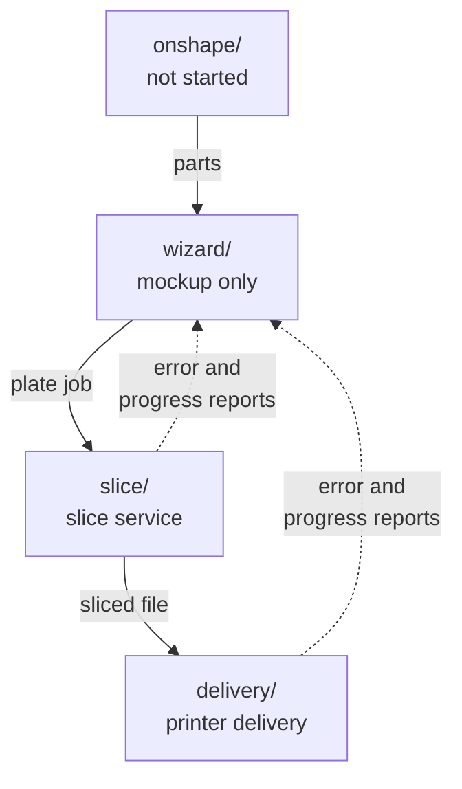

# Penguin Slicer: summary of the session of Thu 11-19 and Fri 11-20

Written Fri 2026-11-20 at 02:30 PT, for the owner. All times are Pacific. It covers one
working session, from the late afternoon of Thu 2026-11-19 to Fri 2026-11-20 02:21 PT,
when the last work was committed. The owner was present until about 23:30 PT on
Thu 11-19; the rest ran unattended.

This file is meant to stand alone. Everything the owner has to answer or do is copied
into section 2 in full. Links to other files are evidence, not required reading.

## 1. Short answer

- The 3D printing work now lives in its own repository, **Penguin Slicer**, at
  `/repos/popcornpenguins/penguin-slicer`. It is local only: nothing is on GitHub.
- **The slice service is ported, hardened and committed.** It had four review rounds of
  its hardening. The last judged it fit, with six low defects and four known gaps open
  (section 4.1).
- **Printer delivery is ported, hardened and committed.** It had six review rounds of its
  hardening: four under the owner's cap, then two more the owner asked for. The last
  found low open items only, on one condition: two of them (P1 and P2, section 4.2)
  become serious if the real printer behaves in a way nobody has yet observed.
- **The wizard exists only as a mockup**, now in its third version, with options for the
  owner to compare (section 2.3).
- **What needs the owner** is in section 2, grouped by kind: decisions (2.1), rulings to
  confirm or reverse (2.2), the mockup's questions (2.3), a session at the real printer
  (2.4), and facts only the real Onshape panel can settle (2.5). Section 7 lists ways
  forward by risk.

## Terms

Each term means one thing everywhere in this file.

| Term | Meaning |
|---|---|
| **Orca** | Orca Slicer, the open-source slicer that turns models into printer instructions. It runs on the server with no window. Version 2.4.2 is the one in use. |
| **H2S** | The team's Bambu Lab H2S printer. |
| **print branch** | The branch `feature/onshape-test-bed` in PenguinCAM, which holds the first attempt at 3D printing. It is now only a source to copy from. |
| **restart notes** | The file of Sun 2026-10-11 that recorded the first attempt and the owner's feedback on it. |
| **plan** | The Penguin Slicer restart plan of Thu 2026-11-19, written in this session. |
| **Penguin Slicer** | The new repository and the product in it. |
| **component** | One of the four parts of Penguin Slicer, each developed as its own project: the slice service, printer delivery, the wizard, the Onshape source. |
| **part, copy, plate** | A part is one distinct solid to print. A copy is one placement of a part. The plate is the printer's bed and everything on it. |
| **slice service** | The component that takes a plate job, runs Orca and returns a sliced file. |
| **HTTP face** | The slice service's small set of web routes: submit a plate job, follow its progress, cancel it, fetch the sliced file. |
| **printer delivery** | The component that sends a sliced file to a printer and reports how the print goes. It has two halves, the relay and the daemon. |
| **relay** | The half of printer delivery that runs on the server. |
| **daemon** | The half of printer delivery that runs on a computer next to the printer and talks to the printer on the local network. |
| **caller** | The application that uses a component: for the relay, the web application that hands it a sliced file and shows its progress to a student. |
| **wizard** | The step-by-step user interface (Setup step, Parts step, Layout step, Preview step), designed for Onshape's right panel, about 320 px wide. |
| **advanced mode** | The wizard's view that shows every slicing setting. |
| **Onshape source** | The component that turns a selection in Onshape into the parts to print. Not started. |
| **mockup** | A click-through imitation of the wizard that runs in the browser with nothing real behind it. It has had three **mockup versions**. |
| **scenario strip** | The yellow bar of controls above the mockup. It is not part of the product. |
| **wizard research** | The study made in this session of how Orca lays out and previews parts, what Onshape allows a panel to show, and how parts can be oriented and arranged in the browser (section 3.5). |
| **resting position** | One way a copy can lie on the plate, with one flat outside face down. |
| **Auto-orient, Arrange** | Two buttons of the mockup's Layout step. Auto-orient chooses each copy's resting position. Arrange places every copy on the plate. |
| **plate job** | A complete request to slice: the parts, where each copy sits on the plate, and the chosen profiles and settings. |
| **slice job** | One plate job being worked on by the slice service, from arrival to its end. |
| **sliced file** | The `.gcode.3mf` file Orca writes, which the printer runs. |
| **error report** | The one shape in which every component reports a failure: a stable code, what happened, where, what to do, and the underlying detail for the log. |
| **progress report** | The one shape in which every component reports how far a long job has got. A progress report is **stale** when the daemon or the printer has not been heard from for a stated time; it then carries a marker and the age of the last word. |
| **memory estimate** | The slice service's rough prediction of the memory a plate job needs, from the volume of its parts. |
| **watchdog stop** | The slice service stopping Orca because Orca's measured memory passed the ceiling. |
| **delivery job** | One sliced file on its way to one printer, from the send until the print ends. |
| **start command** | The message the daemon sends the printer to begin printing an uploaded file. |
| **status document** | One message of the printer's own report of its state. It may carry every field or only the fields that changed. |
| **picture** | What the daemon knows of the printer's state, built from status documents. It is **whole** when it includes the printer's main state, and **fresh** when its last status document is at most 15 seconds old. |
| **hold** | The daemon's refusal to send any other start command to a printer until evidence settles what became of the last one. |
| **simulated printer** | A program that answers the daemon as an H2S would, over real network connections, from scripted status documents. |
| **upstream** | Open-source code written by others that a component rests on: Orca for the slice service, the `bambulabs_api` library for the daemon. |
| **port** | Copying code and tests from the print branch into Penguin Slicer without changing behaviour. |
| **hardening** | Making a ported component robust: errors, progress, cancellation, cleanup, logs, and a routine way to take new upstream versions. |
| **phase** | Either the port or the hardening of one component. |
| **fast suite** | A component's everyday tests: no real Orca, no real printer, no real waiting. |
| **property test** | A test that runs many randomly generated sequences and checks that a rule holds in every one. |
| **brief** | The written instructions given to an agent for one piece of work. |
| **builder** | An agent that wrote or changed a component. |
| **review round** | One check of a component by a fresh reviewer that never sees the builder's own account: it reruns the tests many times in random order, breaks the code on purpose to see whether tests notice, and tries hostile inputs. |
| **fix round** | A builder's work on the defects one review round found. |
| **defect** | Something a review round found that can mislead a user, lose work, hang, leak, fail now and then, or hide a failure. |
| **open item** | A defect not yet fixed, or a known gap that is not a defect. Reviewers graded open items **serious** (can lose work or start a print wrongly), **medium** (blocks or misleads a user until someone intervenes) or **low** (rare, small, or visible only to a developer). |
| **coordinator** | The main Claude session, which planned, wrote the briefs, made rulings and committed. |
| **ruling** | A decision the coordinator made where the owner had not decided. |
| **ledger** | The coordinator's running record of every dispatch, return and ruling. |
| **guide** | A component's `README.md` in the repository. |

## 2. What needs you

Numbered so each can be answered by its number. Within each group the order has no
meaning.

### 2.1 Decisions

| # | Decision | What is known |
|---|---|---|
| D1 | **The repository's name, owner and visibility on GitHub.** | It is a local git repository with no remote. A proposal from the plan: `penguin-slicer`, under the owner's own account while it is being built. The owner creates it and adds it to the workspace. |
| D2 | **Printer delivery, open items P1 and P2: keep the timed rule, or adopt the safer rule?** | **Timed rule, as built.** After a start command, if 5 minutes pass with no proof either way, the printer is taken not to have started the file and is free again (P2). A daemon that could not watch the start, because it restarted or lost the printer, takes an end shown by the printer as this print's end once the command is 5 minutes old (P1). If the H2S is slower than that to show a print, or keeps showing the previous print's end under the new file's name for that long, the delivery job gets a wrong final answer and a resend sends a second start command. **Safer rule, proposed by the fifth review round.** When the 5 minutes pass without proof, end the delivery job as "outcome unknown: the printer has the file and never showed the print; look at the printer", and keep the hold until a picture proves the printer moved on or a person says it is clear. No clock then ever frees a printer for a second start command. **Its two costs:** one confirmation by a person after every start the printer truly ignored; and a daemon that could not watch can never report `done` from an end that might be left over, so a print that really finished is reported "outcome unknown" unless a recording shows a field that tells the two ends apart. The second cost conflicts with ruling R18. The session at the real printer (section 2.4) may make the choice unnecessary: if the H2S shows a print within seconds and drops the previous end at once, neither case can happen. |
| D3 | **Whether to fix the remaining small open items now.** | For printer delivery: P3 to P9 (section 4.2), each with its fix named; P5, the slower fast suite, bears on the owner's rule about slow tests. For the slice service: S1 to S6, S8 and S10 (section 4.1), each small. S7 and S9 are not small; they are D5 and D4. |
| D4 | **A patch to Orca for one poorly reported failure.** | A thin, tall part can fail with only "The slicer could not slice this plate", because Orca keeps the real reason (for example "floating regions") in its debug log only. The proposed patch is a few lines in Orca's `src/OrcaSlicer.cpp` that copy the reason into the result file Orca already writes. Applying any patch means building Orca from source, a large build that was not attempted. The alternative, reading Orca's debug log on failure, works but relies on a log format Orca does not promise to keep. The patch note is in `slice/patches/orca/README.md` in the repository. |
| D5 | **Orca 2.5.x.** | The upgrade command was tried on Orca 2.5.1 (released Sat 11-14). It downloaded, verified and installed, then stopped: 2.5.1 ships the Bambu Lab profiles packed in one file (`BBL.opc`) that the script building the profile catalog cannot read. Going back to 2.4.2 restored everything exactly. Until that script learns the format, the slice service stays on 2.4.2. The size of that work is unknown until the format is examined. |
| D6 | **Daemon telemetry** (the daemon reporting its own state to the server from the moment it starts). | On Fri 10-09 the owner called this the most important lesson of the first hardware test. It was left out of hardening; structured log lines on both halves are in. Part of printer delivery next, or later work? |
| D7 | **Where Penguin Slicer's specs and plans live.** | So far in the notes repository, as PenguinCAM's do. The alternative is the new repository's own `docs/`, beside each component. |
| D8 | **The reference plates**, the set of plates the team wants to be able to print, which decides what "big enough" means for the slice service and its host. | The set proposed in the restart notes, which ruling R17 adopted for the night: (1) a typical FRC mechanism plate of several different functional parts; (2) a full plate of small copies, up to the limit of 25 copies; (3) one large organic part; (4) a plate of two or three large organic parts; (5) one of these with supports on. Hardening measured eight synthetic plates on these lines (section 4.1). No real team plate has been measured. Confirm the set, or name the plates. |
| D9 | **The printer's certificate.** | The `bambulabs_api` library accepts any certificate the printer presents. Pinning the printer's certificate when the daemon is paired is possible; it was not built. |
| D10 | **The Raspberry Pi installer.** | The ported `install.sh` and its service unit are left in the repository untouched and marked as not maintained. Keep them there, or remove them? |
| D11 | **The workspace instructions file.** | The coordinator replaced the section "Restarting the PenguinCAM 3D print path work" in `/repos/popcornpenguins/CLAUDE.md` with a section pointing at the plan. If that file is generated from somewhere on the Mac, the change must be carried to its source or it will be lost. |

Decided by the owner during the session, recorded here so they are not asked again: the
daemon stays in Python for now and moves to Rust or Go later; for this version the daemon
is a plain Python program run by hand on any operating system, with no installers, no
service setup and no operating-system protection of its stored secrets; advanced mode
stays in the same browser tab as Onshape; the owner's global instructions are not to be
changed.

### 2.2 Rulings made on your behalf: confirm or reverse each

| # | Ruling | The alternative |
|---|---|---|
| R1 | **Slice service: a memory watchdog replaces refusing plates on the memory estimate.** The memory estimate refused one 100 mm solid cube as "about 1,158 MB" when it slices at a peak of 276 MB. Now the slice service watches the running Orca's memory and stops it past a ceiling (a setting, 900 MB by default) with a truthful out-of-memory error report. The memory estimate is only logged. | Refuse before slicing on the memory estimate. That is cheaper for an oversized plate but wrong for many ordinary ones until the estimate is refitted on real plates. |
| R2 | **A complete, valid sliced file is never discarded by a stop the slice service itself decides on** (a timeout or a watchdog stop), even if the stop landed in the instant before Orca exited. The slice job succeeds with the stop noted. Near the ceiling a slice may therefore be stopped or delivered with a note, depending on timing; it is never silent. | Treat the ceiling and the timeout as hard: discard a finished file whose slice touched them. |
| R3 | **A cancel the caller asked for discards the file even if Orca happened to finish**, and so does the cancel of a slice job that every client following it has left. This holds through the HTTP face. On the command line and through the Python function, a cancel in the last tenths of a second still delivers the file (open item S10): in the final review round's random-stop runs, 8 of 34 such cancels delivered it. | Deliver a file that finished in the instant of the cancel, everywhere. |
| R4 | **A patch to Orca is always the owner's decision**, and the upgrade command stops when a patch file exists, since applying one needs a source build. Patches to the Python printer library may be made by an agent; none was needed. | Build Orca from source as part of the upgrade command. |
| R5 | **Printer delivery: only evidence that the print has ended ends a delivery job.** Silence never does, except under R7. A pause, a clearable error, an open door or run-out filament gives a non-final stage, "waiting for a person", and the delivery job returns to printing on resume. | End a delivery job after a time without word. That reported running prints as failed. |
| R6 | **The printer's main state decides whether a print is going on**; its stage code only describes it. A main state the daemon does not know refuses a new send with its own retryable error report and never locks a caller in. | Guess from the stage code. That made an idle printer read as printing and blocked every send. |
| R7 | **"Outcome unknown".** After a print has started, a caller may stop following a delivery job whose progress report has gone stale, and the relay does the same by itself after 24 hours of continuous staleness. The record ends with an error report that says contact was lost, the print may still be running or may have finished, check the printer. It never says the print failed. | No time rule at all: a printer switched off for good then leaves a record that lives for ever. The 24 hours is a choice and one setting. |
| R8 | **A printer whose last print ended, well or badly, is free for a new send.** | Refuse sends until the printer's screen is cleared. Whether the H2S needs that is on the checklist in section 2.4. |
| R9 | **A start command is sent only on a whole, fresh picture that positively says the printer is free.** Without one the daemon asks the printer for a whole status document and waits, and a cancel still works. | Start on the last known state. That allowed a second file to start while a first was printing. |
| R10 | **After a start command the daemon holds the printer** until evidence settles the first start. A printer slow to show the print gives a non-final stage, "has the file and has not shown the print yet". The time limits are named settings, all guesses until the H2S is timed (section 2.4). | A fixed 60-second failure, which the port had. |
| R11 | **Every final progress report is kept 24 hours**, so a caller that polls slowly still learns how a delivery job ended. | Drop the record sooner. |
| R12 | **A relay restart keeps nothing but its secret key.** An in-flight delivery job is not resumed: every party ends in a defined state and the caller gets an error report. This was the builder's choice, accepted by the coordinator. | Store delivery jobs on disk so a restarted relay resumes them. |
| R13 | **A small HTTP face was added to the slice service** (submit a plate job, follow its progress, cancel, fetch the file), because streaming progress and vanished clients cannot be proven without one. | Library and command line only, as the plan first said. |
| R14 | **The simulated printer's status sequences are invented** from the one status document recorded on Fri 10-09, and the daemon has a `record` command to capture real ones. | Wait for recordings before building it. |
| R15 | **The print branch's "local mode" was not ported.** In Penguin Slicer, using the tool without Onshape is to be the wizard's own file upload; until the wizard exists, each service runs from the command line. | Port the stand-in Onshape page as well. |
| R16 | **Open items P1 and P2 were left unchanged** in the last two fix rounds, because their fix changes what a person must do (decision D2). | Adopt the safer rule without asking. |
| R17 | **The reference plates for the night's measurements were the set proposed in the restart notes** (listed in decision D8). | Wait for the owner to name real plates. |
| R18 | **An end counts only as an end of this print.** An end state left over from the previous print, seen just after a start command, means "not showing our print yet"; and a daemon that restarts after a real end must still find it. The second half is what the safer rule of D2 would give up. | Take any end the printer shows after a start command as this print's end. |

### 2.3 The mockup

**Open it:** [mockups/print-wizard/index.html](../mockups/print-wizard/index.html). In
the owner's Markdown viewer that link opens the working page
(`http://127.0.0.1:6249/PenguinCAM-notes/mockups/print-wizard/index.html`); from a
session, `open /repos/popcornpenguins/PenguinCAM-notes/mockups/print-wizard/index.html`
does the same. No server needs starting beyond the viewer. Its companion,
[DECISIONS.md](../mockups/print-wizard/DECISIONS.md), lists every design choice and
everything that is faked; its questions are copied below.

**How it works.** The dark panel on the right is the wizard; go through it with Next. On
the Parts step, click parts in the list or the picture on the left, as in Onshape. The
scenario strip arms errors, changes the panel width, switches between a Part Studio, an
Assembly and a standalone page, sets the speed of the mocked progress, and, new in mockup
version 3, switches three sets of options. Nothing is real: no slicing, no Onshape, no
printer.

**What changed in mockup version 3**, from the owner's reactions of Thu 11-19:

- The Layout step has no modes. The Lay on face tool is gone.
- Parts arrive lying their best way. The Shooter Hood Rib lies flat, 8 mm tall, where it
  stood 353 mm. A selected copy offers "Put back as modelled".
- Arrange tries two ways of packing the copies and keeps the result that leaves fewer
  copies off the plate.
- Advanced mode stays in the panel as a full-height view, and lays out wider when the
  panel is wider. Onshape offers a right-panel application no dialog and no way to resize
  the panel; the wizard research checked that against Onshape's list of panel messages.

**The options to compare, by their names in the scenario strip:**

| Menu | Options |
|---|---|
| **Lay on face** | *Pictures under the view* (the wizard research's choice): a row of small pictures, one per resting position. *Arrows on the part's faces*: amber arrows on the selected copy; a click lays it on that face. *Box around the part* (the owner's idea): a box whose sides are clicked, or which is dragged, to put that side down. *Tip handle*: a second handle that steps the copy to its next resting position. A double-click on a flat face works under all four. |
| **Mouse** | *Like Onshape* (right-drag turns the view), *Like a slicer* (drag on empty plate turns it, right-drag slides it), *Top-down first* (the view starts from above). |
| **Parts arrive** | *lying their best way*, or *as modelled*. |

The options behave differently on a small blocky part and on a long thin one, so the
L Bracket and the Shooter Hood Rib make a useful pair. The agent that walked mockup
version 3 told the coordinator that *Box around the part* was the weakest of the four on
thin parts; that remark is recorded only in its message, not in a file.

**The questions for mockup version 3**, copied from `DECISIONS.md`. Each can be answered
in a sentence.

| # | Question |
|---|---|
| M1 | **Lay on face: which one?** *Pictures under the view*, *Arrows on the part's faces*, *Box around the part*, or *Tip handle*? Try each on the L Bracket and on the Shooter Hood Rib: they behave differently on a small blocky part and on a long thin one. |
| M2 | **Mouse: which one?** *Like Onshape*, *Like a slicer*, or *Top-down first*? |
| M3 | **Parts arrive: lying their best way, or as modelled?** Lying their best way, the Shooter Hood Rib arrives flat and the student can put it back as modelled; as modelled, it arrives standing 353 mm tall with an error and an Auto-orient button. |
| M4 | **Advanced mode at 320 px:** do the search box, the Common / All settings switch, the tab row and the collapsing subgroups make the settings findable, or is the column still too cramped? |
| M5 | **Advanced mode when the panel is wider:** the tabs become a rail on the left once the panel is 480 px wide, and the subgroups sit in two columns once it is 700 px wide; the scenario strip's 560 px and 760 px settings show each. Onshape offers no dialog, so a panel dragged wider is the only "bigger" there is. Is that enough? |
| M6 | **Arrange and Auto-orient stay two buttons:** Arrange decides where copies sit and keeps how each one lies; Auto-orient decides how they lie. Arrange offers to lay copies their best way only when it has checked that more would then fit. Right, or should Arrange always auto-orient first, even if that undoes a way the student chose? |
| M7 | **The status line:** the plate's state is one line above the picture, where before it was a red bar inside the picture that could cover a copy or the rotation handle. Does one line say enough, with the full sentences and their buttons below? |

**Questions from mockup version 2 that version 3 did not settle.** Version 2 asked ten.
Three are closed: how to lay a copy down and how parts arrive are now M1 and M3, and
whether a stage-by-stage bar would do if Orca gave no percentage is moot, because Orca
does report a percentage (section 3.4). The other seven still stand:

| # | Question |
|---|---|
| M8 | **Is the 3D view big enough at 320 px?** The Layout step stays at panel width and zooms to the copies. Workable, or should the Layout step fill the whole panel as advanced mode does? |
| M9 | **When a laid-down copy needs more room** it moves to the nearest free spot; if there is none, the whole plate is arranged again, which moves copies the student may have placed by hand. Acceptable, or should other copies never move unless the student presses Arrange? |
| M10 | **Confirming a send.** Send to Printer always asks once more, naming the printer, the copies, the time and the filament. Every time, or only the first time in a session? |
| M11 | **Print progress.** After a send, a card shows the stage (Sending, Heating, Leveling, Printing, Done), percent, layer of total, time left and the expected finish time, and the layer preview follows the printer. What else would a student standing at the printer want there? |
| M12 | **Stopping things.** A slice can be cancelled at any moment. A send can be cancelled until the file has arrived. A running print cannot be stopped from the panel; the card says to use the printer's screen. Do you want pause or stop from the panel? |
| M13 | **Changing the profile keeps your changes.** If a student raises infill and then picks another profile, the change stays on top of the new profile and a sentence says so. Keep the changes, or clear them when the profile changes? |
| M14 | **A repeat click on a listed part** only flashes the row and says to raise the quantity; a ↻ button on the row brings in a changed part from Onshape. Should a repeat click raise the quantity instead? |

Two things the mockup cannot show honestly and that need a requirement, not a reaction:

| # | Question |
|---|---|
| M15 | What should **Cancel slice** do while the connection to the server is lost? The mockup cancels as if it could reach the server. |
| M16 | Which of Orca's other layout tools count as needed? The mockup leaves out scale, cut, mirror and per-part settings. |

**Faked in ways that could mislead.** The toolpaths in the layer preview are generated
shapes, not G-code. Slicing stages, times and percentages are invented (the real slice
service does report Orca's own stages and percentage; the mockup does not use them). The
"overhangs" label on a resting position uses an invented threshold. Advanced mode shows
about 95 of Orca's roughly 295 process settings. The panel's drag limits (240 to 800 px)
are not Onshape's. The full list of 26 is in `DECISIONS.md`.

### 2.4 The session at the real printer

No real printer was available. Every status sequence in the simulated printer is invented
from one recorded status document. One session at the H2S, with the daemon recording,
replaces invention with fact and settles decision D2.

**How to record a print**, on the Windows computer on the printer's network (the same
commands work on macOS and Linux, with `python` in place of `py`):

1. Install Python 3.11 or newer from python.org; tick "Add python.exe to PATH".
2. Get the daemon's code onto that computer. The repository has no remote, so it cannot
   be downloaded. The guide's way: in the repository, run `make -C delivery
   daemon-tarball`; copy `delivery/dist/penguincam-printer-daemon.tar.gz` to the Windows
   computer; unpack it (`tar -xzf penguincam-printer-daemon.tar.gz`; Windows 10 and later
   include `tar`); then `py -m pip install .\penguincam-printer-daemon`. The guide does
   not say more than this, and the tarball has not been unpacked on Windows by anyone.
   Once D1 is settled and the repository is on GitHub, cloning it and running
   `py -m pip install .\delivery\daemon` is the other way.
3. `py -m penguin_delivery_daemon pair` finds the printer (or takes its address, serial
   and access code typed in) and writes its configuration.
4. `py -m penguin_delivery_daemon record` saves every status document the printer sends,
   one JSON line each, until Ctrl-C. Run it while a print goes from start to finish, and
   again for a print stopped on the screen and one paused by hand.
5. Bring the recording files back. An agent puts them in `delivery/simulator/scenarios/`
   as that folder's README says and runs `make -C delivery test-sim`; the simulated
   printer then replays the real printer.

**What these steps do not cover.** They record prints started some other way (from the
printer's screen, or from Bambu's own slicer), which is what the simulated printer needs.
They do not settle decision D2. The two checklist lines that settle it measure what the
H2S reports after a start command sent by the daemon, and that needs three more things:
a relay for the daemon to talk to, the daemon's `run` command, and a sliced file to send.
None of that is worked out for the Windows computer yet:

- `pair` with no `--backend` option points the daemon at
  `https://penguincam.popcornpenguins.com`, where no relay for it runs. A relay must be
  started somewhere the daemon can reach (the guide's "Try it on one machine" starts one
  with `python -m together.relay_server`) and its address given to `pair`.
- Neither the guide nor the scenarios' README says whether `record` and `run` can be
  connected to the printer at the same time.

So the session has two parts: recording prints started at the printer, which the steps
above cover, and a daemon-started print with recording, which an agent should prepare as
a written walk and try against the simulated printer first.

Everything the daemon keeps is in one folder: `%LOCALAPPDATA%\PenguinDelivery` on Windows,
`~/.penguin-delivery` elsewhere, or the folder given with `--home`. The recordings are in
its `recordings` folder.

**Checklist for the Windows computer.** This list is the builder's own, from its account
of the hardening; it is not in the guide and no review round checked it. Nothing here has
run on Windows.

- [ ] `py -m pip install` of the daemon works in a fresh Python 3.11 or newer.
- [ ] `py -m penguin_delivery_daemon pair` writes
      `%LOCALAPPDATA%\PenguinDelivery\config.toml` and prints the run command.
- [ ] `py -m penguin_delivery_daemon run` connects, logs "paired with the relay" and the
      idle line, and Ctrl-C stops it cleanly.
- [ ] `status` and `record --seconds 10` run.
- [ ] Discovery of the printer (UDP port 2021) under the Windows firewall: allowed, or
      the typed address path used instead.
- [ ] A delivery job whose file name holds `:` or `?` uploads under a safe name.

**Checklist for the H2S**, copied from the guide. The names in code type are fields of
the printer's status documents and settings of the daemon; the recordings answer most
lines without anyone needing to read them live.

- [ ] `record` through one whole print, one print stopped on the screen, and one paused
      by hand (step 5 above turns them into the simulated printer's scenarios).
- [ ] **Whether the H2S sets `print_error` while a print is paused** (filament run out,
      door open, paused by hand), and whether it sets it for a moment while it keeps
      printing. The daemon reads either as waiting for a person, never as an end. If the
      H2S instead goes to `FAILED` for something a person can clear, the delivery job
      ends as failed.
- [ ] **What an idle H2S reports for `stg_cur`** (255, -1, or the last print's stage) at
      power-on, after a finished print and after a stopped one, and what it reports in
      the first seconds after a start command. Any `gcode_state` it sends that the
      daemon's table does not list refuses every send and must be added to the table.
- [ ] **That the H2S accepts a start from its finished and failed states without
      anything being cleared at the printer first**, and how long `FAILED` and
      `print_error` stay after a print is stopped on the screen (ruling R8).
- [ ] Whether a paused H2S keeps sending status documents (if not, a paused print shows
      as stale after 60 seconds, `PRINTER_QUIET_SECONDS`), and what it does with a start
      command while printing.
- [ ] **The first status documents after a start command, one by one** (after a finished
      print, after a print stopped on the screen, from power-on): does `subtask_name`
      change in the same status document as `gcode_state`, or before it, and how long
      does the previous print's end stay? Do `print_error` and the error entries of the
      last print clear, and when? This decides open item P1 and sets
      `LEFTOVER_END_SECONDS` (2 minutes).
- [ ] **How long the H2S takes to show the print after the start command**, for a small
      file and for the largest the team prints. This decides open item P2 and sets
      `START_SLOW_SECONDS` (60 seconds) and `START_SETTLE_SECONDS` (5 minutes), which
      must stay well above the measured time.
- [ ] **Whether the H2S sends whole status documents or only the fields that changed**,
      what the first status document after a connection is, and how long its answer to a
      request for a whole one takes (ruling R9).
- [ ] How often an idle H2S sends status documents by itself, and that it answers a
      request for a whole one every 10 seconds (`REPORT_REQUEST_SECONDS`) for ten minutes
      (`PRINTER_WAIT_SECONDS`) without complaint.
- [ ] Unplug the printer's network between the end of the upload and the start for two
      minutes, then plug it back: the delivery job shows "waiting for the printer" and a
      cancel works.
- [ ] What the H2S reports after it is switched off mid-print and on again. If it offers
      to resume, the delivery job has already ended as failed after two minutes
      (`PRINT_VANISH_SECONDS`) of idle status documents.
- [ ] The printer's codes for a stop on the screen (assumed `0300400C`), for filament run
      out (assumed `07008011`) and for an open door (assumed `0500400E`).
- [ ] The TLS version on the upload port (990), and whether a whole file arrives. In the
      simulated printer, 11 of 12 uploads lost their end under TLS 1.3 until one option
      of the library was set; the real printer's version is unknown.
- [ ] The format of the printer's file listing lines and the size it lists for an
      uploaded file. If the lines do not match what the daemon expects, every upload is
      judged failed.
- [ ] A print shows its stages in order, and the remaining time is in minutes.
- [ ] A cancel during the upload removes the partial file from the printer's list.
- [ ] The printer's certificate (decision D9).

### 2.5 Facts only the real Onshape panel can settle

Nothing in this session ran inside Onshape. These came out of the wizard research.

| # | Fact | How to settle it |
|---|---|---|
| F1 | How wide Onshape lets a user drag the right panel. PenguinCAM's own CNC help says to widen the panel, so a student probably can; Onshape publishes no limits. | Drag it in a real Part Studio and note the widths. |
| F2 | Whether the browser's full-screen request works from inside the panel. | One line in the real panel: `document.fullscreenEnabled`. |
| F3 | Onshape's default mouse mapping (taken from its documentation as right-drag turns the view), and its trackpad and touch gestures. | Try it in a real Part Studio. |
| F4 | What printing needs from Onshape beyond what the CNC wizard does in production: selecting whole bodies, exporting an STL file, picking parts inside an assembly. The print branch has that code; it has never run against real Onshape. | Checked by hand when the Onshape source is taken up. |
| F5 | The speed of automatic orientation and of Arrange in Chrome inside Onshape, on real team parts. Measured so far only on the mockup's generated parts: 0 to 12 ms per part to orient, about 1.5 s to arrange 23 copies. | Measured when the wizard is built. |

## 3. What was done, in order

### 3.1 The replanning conversation (Thu 11-19, late afternoon to about 18:00 PT)

The owner opened by saying the project had been built before its requirements were
understood. The print branch had grown to 412 changed files (about 9,000 lines of program
code, 6,000 of tests, the rest mostly Orca's profile data). The conversation settled:

- The work leaves PenguinCAM for one new repository, never several, built on PenguinCAM's
  stack so it can return later.
- Four components, each developed as its own project.
- The wizard keeps the CNC wizard's conventions and the Onshape panel as its main home.
  The first attempt's fault was missing capabilities, not the wizard's shape.
- Onshape integration is a solved problem (the CNC wizard does it in production) and is
  not treated as a risk.
- Planned work stops at three things: port and harden the slice service, port and harden
  printer delivery, build a wizard mockup. Planning resumes after those.
- The standing quality bar: fast tests that never fail at random, real coverage, and
  errors that say what happened and what to do. An Opus agent builds; a fresh Fable
  reviewer checks; at most four review rounds per phase.

The plan was written up, reviewed twice and committed:
[Penguin Slicer restart plan](../plans/2026-11-19-penguin-slicer-restart-plan.md). It
records the state of Thu 11-19 evening; where it and this file differ, this file is newer.

### 3.2 The repository



Each component has its own folder, tests and guide, runs without the others, and depends
only on the shapes defined in `contracts/` (the plate job, the sliced file, the error
report, the progress report). In production the components may run inside one server; the
files in `contracts/` are seams for development and testing.

### 3.3 The ports (Thu 11-19, about 17:30 to 18:40 PT)

Each service was copied from the print branch by an Opus agent, cut free of PenguinCAM,
and had two review rounds. Faults inherited from the print branch were pinned by tests
for hardening to fix.

| Service | Review round | Defects | The worst |
|---|---|---|---|
| Slice service | 1 | 14 | A good sliced file thrown away when Orca's result file had an unexpected shape |
| Slice service | 2 | 2 | A crash of Orca reported as a kill |
| Printer delivery | 1 | 12 | An accepted send could lose its sliced file to a race the port introduced (3 of 150 sends) |
| Printer delivery | 2 | 1 | A test that failed if a stray system file sat in the daemon's folder |

### 3.4 Hardening (Thu 11-19 18:30 PT to Fri 11-20 02:21 PT)

The owner named the cases that mattered: bad STL files (a broken model once failed every
slice with a useless message), an empty file, out of memory; and for printer delivery,
networks that are slow, intermittent, or "seem down and then recover", on both links, and
the printer's own error codes. The owner also added that taking a new version of upstream
code must be routine, and that small patches to upstream are acceptable for error and
progress reporting only.

The cap was four review rounds per phase. The slice service used four. Printer delivery
used four, and then, at about 23:20 PT on Thu 11-19, the owner asked for two more "to see
if we can get to low issues only"; those are rounds 5 and 6.

| Service | Review round | Defects | The worst |
|---|---|---|---|
| Slice service | 1 | 14 | One test failed 1 run in 20; the memory estimate refused plates that fit |
| Slice service | 2 | 6 | The memory watchdog missed Orca's peak, a spike shorter than a tenth of a second |
| Slice service | 3 | 7 | A stop landing just after Orca wrote its file discarded the file (rare) |
| Slice service | 4 | 6, all low | Fit to commit; nothing that loses a student's work |
| Printer delivery | 1 | 11 | A print that was running was reported as failed after 90 seconds of printer silence, and never corrected |
| Printer delivery | 2 | 6 | A fault a person clears at the printer ended the delivery job as failed while the print finished |
| Printer delivery | 3 | 8 | An unknown printer value blocked every send for ever; two different files could overlap |
| Printer delivery | 4 | 6 | A start command could go out on a partial status document from a busy printer |
| Printer delivery | 5 | 7, all low | Low only on a condition the real printer must confirm (P1 and P2) |
| Printer delivery | 6 | 7, all low | The same condition; the fast suite had grown slow; one fix had no test |

Two findings from hardening that change earlier assumptions:

- **Orca reports real progress.** Its `--pipe` option sends one message per stage with
  its own percentage. The slice service reports those and never invents a figure. The
  restart notes had left open whether Orca, run with no window, reports its stages at
  all; it does.
- **The simulated printer found two faults that fakes could not:** a deadlock in the
  daemon's handling of the printer library's log, which would have hung the printer
  connection on the library's second log line, and uploads losing their end under
  TLS 1.3. Both are fixed.

### 3.5 The mockup and the wizard research

- **Mockup version 1** (Thu 11-19, 17:15 to 17:50 PT): an Opus agent built the whole
  wizard as a click-through page.
- **Mockup version 2** (to Thu 11-19 18:26 PT): two passes by Fable agents improved it;
  the owner tried it late on Thu 11-19.
- **The wizard research** (Thu 11-19 23:23 to 23:36 PT): an Opus agent studied Orca's
  source at version 2.4.2, Onshape's developer documentation and options for laying out
  parts in the browser. Its file:
  [wizard layout and advanced mode research](../research/2026-11-19-wizard-layout-and-advanced-mode-research.md).
  Its conclusions are in section 2.3. It did not run Orca's window. It found that Orca,
  Cura, PrusaSlicer and Bambu Studio all use a mode for laying a part on a face. Orca's
  code for orienting and arranging cannot be copied: Orca is AGPL-licensed and PenguinCAM
  is MIT-licensed, so the mockup's versions are written fresh.
- **Mockup version 3** (Thu 11-19 23:36 PT to Fri 11-20 00:34 PT): an Opus agent applied
  the wizard research, and one pass by a Fable agent walked and corrected it.

## 4. State of each component

### 4.1 Slice service

**What it does.** Takes a plate job, checks every part before Orca runs, slices with
Orca 2.4.2, and returns the sliced file with its summary. Every failure is an error
report that keeps Orca's own reason. It reports Orca's stages and percentage as progress.
A cancel, a timeout or a watchdog stop leaves no Orca process and no files. It writes one
log line per change of a slice job's state. It has a command line, a Python function and
a small HTTP face.

**Run it** (from the repository's top folder):

```
make -C slice install
make -C slice test
make -C slice test-upstream
uv run --project slice python -m penguin_slice slice contracts/examples/plate-job.json --out /tmp/sliced
uv run --project slice python -m penguin_slice serve --work /var/tmp/penguin-slice --port 8640
```

`make test` is the fast suite. `make test-upstream` runs the real Orca and is also the
check that a new Orca version has not broken an assumption. `make upgrade-orca
VERSION=x.y.z` moves to another Orca version.

**Figures from the fourth, final review round** (commit `30401cf`):

| What was measured | Result |
|---|---|
| Fast suite, 45 runs in random order on 2 worker processes | 45 of 45 passed; 858 tests; 3.8 to 10.2 seconds a run. The slow runs were under load from the reviewer's own Orca slicing at the same time; alone the suite took 4.2 seconds. |
| Tests that run the real Orca, 3 runs | 3 of 3 passed; 32 tests; 23 to 27 seconds a run |
| Branch coverage of the package under the fast suite | 100% |
| Checks broken on purpose by the reviewer | 18 of 20 noticed by the tests; the other 2 change nothing visible |
| Real slices stopped at random moments | 150; 40 were delivered, each with G-code identical to a clean slice |
| Cuts of a real sliced file offered as a finished one | 3,400; every one refused |

The owner's named cases all gave true sentences: an empty file; the 33 files of the
hostile-file corpus (26 refused with a true sentence, 6 sliced correctly, 4 of those with
a warning, and 1 failed in Orca with a true sentence) and the reviewer's own files; a
stand-in for the broken Eiffel tower model with supports off and on; out of memory;
progress; cancel; a vanished client.

**Memory, measured by the builder and not repeated by a reviewer.** One slice at a time,
default profiles, eight synthetic plates: the highest peak was 915 MB, for three large
smooth bodies with supports on (1,398 cm³ in all). A plate of 25 small hubs peaked at
781 MB. One 100 mm solid cube peaked at 276 MB. These were measured under a 3 GB stop
rule, before the watchdog existed. The 915 MB plate is above the default ceiling of
900 MB, so by rulings R1 and R2 the slice service would now stop it as out of memory, or
deliver it with a note if Orca finished first; that plate was not run again at the
default ceiling. No real team plate was measured, nor CPU time, nor how many slices can
run at once.

**Open: six low defects (S1 to S6) and four known gaps that are not defects (S7 to S10).**
None can lose a student's work.

| # | What | To a user | How likely | The fix |
|---|---|---|---|---|
| S1 | When a slice is delivered after a timeout or a watchdog stop, the command line prints no note of the stop (the HTTP face logs it). | A person slicing by hand would not know the slice touched the limit. | Rare: a window of about 30 ms. | Print the notes with the summary; small. |
| S2 | The summary of a sliced file travels in an HTTP header that reaches 8 to 17 kB when 25 parts each carry a warning. | A proxy in front of the slice service may refuse the download of a good file. | Low. | Serve the summary as a body; small, but it changes the HTTP face and its client. |
| S3 | One rare kind of damage to a sliced file is reported as "The slicer failed unexpectedly". | A vaguer sentence than the true one, and marked not worth retrying when a retry would work. | Very low. | One line and a test. |
| S4 | A script that calls the slicer's inner function directly and reuses an output folder can be handed an old file after a stop. | None through the slice service, which always uses a new folder. | Only for someone writing a new script. | Remove an existing file before starting Orca; small. |
| S5 | The peak memory in the log can include the slice service's own memory. | A support reading could be misled on small plates. Nothing is refused because of it. | Low. | A sentence in the guide, or take the peak from the watchdog alone; small. |
| S6 | A memory ceiling setting typed with a digit that is not a plain 0 to 9 makes every plate job fail. | Every slice fails until the setting is corrected. | Very low; only at set-up. | Accept plain digits only; one line. |
| S7 | Orca 2.5.x cannot be taken yet. | None now. | Certain at the next upgrade. | Decision D5; size unknown. |
| S8 | The guide does not say the slice service must run as one process. | Behind a server that starts several, a client would lose its slice job. | Only at deployment. | Two sentences in the guide, or a production entry point when hosting is chosen. |
| S9 | A thin, tall part can fail with only "The slicer could not slice this plate". | A general sentence where Orca knew the reason. | Occasional, with unusual parts. | Decision D4. |
| S10 | Ctrl-C in the last instant of a command-line slice delivers the file (see ruling R3). | Harmless: the file is correct. | Rare. | Apply the cancel as the HTTP face does, or amend the guide's sentence; small. |

Also known and stated in the guide: parts that intersect themselves are not detected
before slicing; the expected slicing time is only within about a factor of two.

### 4.2 Printer delivery

**What it does.** A caller gives the relay a sliced file for a team's printer. The daemon
fetches it, uploads it to the printer, and starts it under rulings R9 and R10. The caller
follows a stream of progress reports through the whole delivery: waiting, downloading,
uploading, starting, then the print with its stage, percent, layer and minutes remaining,
marked stale when the daemon or printer has gone quiet. Both faults of the first hardware
test (Fri 10-09) are fixed: the start check reads the field the H2S actually fills, and
an upload is judged by the size the printer lists for the file. The daemon is a plain
Python program started by hand on Windows, macOS or Linux.

**Run it** (from the repository's top folder):

```
make -C delivery install
make -C delivery test
make -C delivery test-sim
make -C delivery test-upstream
make -C delivery together
```

`make test` is the fast suite. `make test-sim` runs the daemon against the simulated
printer. `make test-upstream` checks the assumptions about the printer library. `make
together` sends a sample file through relay and daemon in one process. The guide's
section "Try it on one machine" walks the whole chain by hand with the simulated printer
in four terminals. `make upgrade-printer-library` moves to another library version.

### Outcome of the last round

The last fix round worked on the five small open items of the fifth review round and on
the property tests. The sixth and final review round (Fri 11-20, returned 02:21 PT)
checked it, and the result is commit `9989a12`.

- **Fixed and confirmed, with one stated exception:** the hold now survives the daemon
  and the relay both restarting, as long as the daemon's record of the start command is
  still in its folder (the daemon keeps a small record of each start command it sends).
  The exception is by design: if that record is gone, or names another printer, and both
  halves restart after the command was sent, nothing is left that knows of the start, and
  a second start command can go. The reviewer notes that a power cut at the wrong moment
  can leave the record missing. A
  cancel after a daemon crash no longer claims a start command was sent when none was; a
  delivery job that waited behind the hold on a flaky printer network now gives its true
  reason; the guide's hand walk works as written; every time limit in the guide carries
  its setting's name.
- **Left as they were, by ruling R16:** P1 and P2. The guide now states both limits and
  the safer rule in a subsection, "Two limits that wait for the real printer".
- **New in this round:** the fast suite takes about 7 seconds where it took about 4 (P5),
  and one of the round's fixes has no test that fails when it is undone (P3).

**Figures from the sixth, final review round** (commit `9989a12`):

| What was measured | Result |
|---|---|
| Fast suite, 40 runs in random order on 2 worker processes | 40 of 40 passed; 1,125 tests; about 7 seconds a run on a quiet machine (6.65 to 7.38), up to 12.6 under load |
| Simulated-printer suite, 10 runs | 10 of 10 passed; 36 tests; 15 to 17 seconds a run |
| Check of assumptions about the printer library, 5 runs | 5 of 5 passed; 55 tests; 16 to 17 seconds a run |
| The record of a sent start command, 180 aimed cases in all | With the record whole, half written, damaged, unreadable or out of date: a second start command in 0 of 144 cases; a damaged record never freed a printer and none blocked one for ever. With the record removed or naming another printer, both halves restarted and the command already sent: a second start command in 6 of 6 cases, as the design says. |
| The reviewer's own random sequences of faults, restarts, cancels and resends around a start: 4,000 with shortened time limits, 300 with the real ones | In all 4,300: no file sent a start command twice; no start command onto a busy or held printer; no untrue "already sent"; no delivery job that never ended. **But 109 wrong final answers:** 41 `done` for a print the printer never showed, and 68 ends blamed on a printer error that did not exist. Every one of the 109 is open item P1: a daemon that could not watch, and a simulated printer that kept the previous end under the new name. |
| Faults put back into the code on purpose by the reviewer, 14 | 13 noticed by narrowly aimed tests within 4 to 11 seconds; the one not noticed is open item P3. The three property tests by themselves noticed 8 of the 14. |

**Why the fast suite got slower, and the remedy.** Three property tests now take about
3.3 of the 7 seconds a person waits; the other 1,122 tests take what they took before.
They run 260 random sequences where they ran 110, each through the relay's real routes.
The reviewer's remedy: move those three to their own make target, run before a commit and
by reviewers, and keep in the fast suite about eight fixed sequences written out by hand,
one for each fault the random ones are known to catch. The fast suite then returns to
about 4 seconds. Simply running fewer random sequences was tried and loses two of the
faults they catch now. This matters because the owner said "slow flaky tests are the bane
of making good progress"; nothing here fails at random, but the suite is slower than it
was, and a real bug can make it much slower (P4).

**Open at `9989a12`.** The sixth review round rated all nine low, P1 and P2 on condition.

| # | What | To a user | How likely | The fix |
|---|---|---|---|---|
| P1 | A print can be reported as finished, or as failed, when it has not begun. The mechanism is in decision D2. | A wrong final answer, and the printer counts as free, so a resend sends a second start command. | Unlikely: it needs a daemon that could not watch and a printer holding an old end under a new name for 5 minutes, and nobody has seen an H2S do that. **Serious if the H2S does.** | A recording that rules it out, or the safer rule of D2. |
| P2 | A printer that takes more than 5 minutes to show a print it accepted is reported as not having started it. See D2. | A failure message for a print that is beginning; a resend sends a second start command. | Unlikely: the one recorded status document suggests seconds. **Serious if the H2S is that slow.** | A measured time and a setting well above it, or the safer rule of D2. |
| P3 | One of the last round's fixes (the hold counted some time twice after a restart) is not protected by any test. | Nothing now. If someone later undoes the fix by accident, a second start command can go to a printer about three minutes after the first, and no test will say so. | Only if that code is edited again. | One test; the reviewer wrote out the sequence. |
| P4 | When a real bug is introduced, the fast suite can take more than five minutes instead of failing in seconds, because a failing property test spends minutes reducing its example and the 30-second limit on each test does not stop that. | Nothing. A developer waits a long time for a failure. | Certain for some bugs: seen with 1 of 14 tried, and 3 more ran past 150 seconds. | A setting on three tests, or the remedy of P5. |
| P5 | The fast suite takes about 7 seconds where it took about 4. | Nothing. A developer waits longer on every run. | Certain. | The remedy described above. |
| P6 | After the daemon restarts and finds a damaged or out-of-date record of a start command, the next print waits 5 minutes before it starts. | One delay of 5 minutes, with a message about an earlier print where there may be none. | Unlikely: a daemon restart together with a damaged file or a relay restart. | A few lines and a test. |
| P7 | The guide says time when the printer is silent never counts towards releasing the hold, and in one corner it does: when nobody is following the first delivery job and the printer was off the network. | Nothing beyond P2. | Inside P2's case only. | One sentence in the guide, or a few lines. |
| P8 | The daemon's log has a line that looks like an error when a cancelled file was never on the printer, and says it removed it. | Nothing; whoever reads the log for support sees a false alarm. | Certain in that case. | Reword one line. |
| P9 | Pressing Ctrl-C several times at once can end the daemon's log with a Python error trace. | An alarming last line; the daemon has stopped correctly. | Seen once, with three interrupts at once. | A few lines. |

Not handled, by design, and stated in the guide: stopping a print that is already running
(it must be stopped at the printer); the printer's certificate (decision D9); a relay
restart does not resume an in-flight delivery job (ruling R12).

### 4.3 The wizard

A mockup only (section 2.3). No product code exists. Its requirements are to be written
from the owner's answers to M1 to M16 and whatever else the owner says after trying it.

### 4.4 The Onshape source

Not started. The folder is empty. The print branch holds code for selecting parts and
exporting STL files that has never run against real Onshape (fact F4).

## 5. What went wrong or deserves a caution

**The coordinator's own mistakes**

- **Times written without reading the clock.** For about 25 minutes on Thu 11-19 (real
  time about 18:00 to 18:22 PT), the coordinator wrote times into the ledger and into
  messages that ran up to about 30 minutes ahead of the real time, including the times
  attached to three of the owner's decisions. The order of events was right. The ledger
  carries a correction, and every time after it was read from the clock.
- **Files edited through scripts.** The coordinator told every agent to edit files only
  with the editing tools, and itself changed the plan, the ledger and the briefs through
  small scripts several times.
- **A first misreading of the risks.** Early in the conversation the coordinator listed
  Onshape's messages and slicing progress as large unknowns. The owner corrected both:
  the CNC wizard already does the Onshape part in production, and the owner's point about
  progress concerned the print as well as the slice.

**Incidents**

- **Out-of-memory kills.** During the third review round of printer delivery's hardening
  (Thu 11-19, about 21:14 to 21:19 PT) the reviewer put faults back into the code that
  made tests loop for ever. Its time limit stopped the wrapper program and not the tests,
  which grew to 2.1 GB on a machine with 5 GB, and the container recorded two
  out-of-memory kills. The slice review round running at the same time returned normally,
  and its figures were checked again in the next round. Every test now has a hard time
  limit from outside the test.
- **Rule lapses the agents reported themselves:** several chained shell commands with
  `cd ... &&`; two changed a line with `sed`; one made a batch of edits through a script. None
  wrote outside its folder, and none ran a git command that writes.
- **A builder went beyond its list once.** In the last fix round the builder also fixed
  the double-counting in the hold, which changed the hold's timing. The final review
  round checked the hold again and found it sound, but that fix is the one with no test
  (P3).

**Claimed, but checked by no independent review**

- **The mockup's last two changes in version 3:** a text change in the selection row made
  after the final reload, and the "Lay them the best way" button, which never appeared on
  any plate the walking agent built. The coordinator loaded the page afterwards and saw
  it render with no console errors, nothing more.
- **The upgrade commands.** The builders ran them (Orca to 2.5.1 and to 2.4.1 and back;
  the printer library to 2.6.5 and back). The reviewers read the commands and did not run
  them, because running them rewrites files in the repository.
- **The memory measurements** of section 4.1 are the builder's.
- **The checklist for the Windows computer** in section 2.4 is the builder's.
- **Windows.** The daemon has never run on Windows. Tests exercise each
  platform-dependent choice with the platform faked.
- **The Raspberry Pi installer** was never run in the new repository.
- **The wizard research's facts about Onshape and Orca** come from documentation and
  source code. Orca's window was not run, and nothing was tried in a real Onshape panel
  (section 2.5).
- **Mockup below 1,450 px of window width:** the scenario strip wraps to three rows.

## 6. Where everything is

| What | Where |
|---|---|
| The repository | `/repos/popcornpenguins/penguin-slicer`, branch `build/ports-and-hardening`. **Local only: no remote, nothing pushed.** |
| Its commits, oldest first | `cbd912c` skeleton and the error and progress contracts; `7e1e2e1` printer delivery port; `c2c9a3c` slice service port; `30401cf` slice service hardening; `81b5f4a` printer delivery hardening; `fce698d` notes for agents; `5d38566` printer delivery, how a start is decided; `9989a12` printer delivery, the hold survives restarts |
| Guides | `slice/README.md`, `delivery/README.md`, `contracts/`, and `CLAUDE.md` (commands, the quality bar and lessons learned) in the repository |
| The plan | [plans/2026-11-19-penguin-slicer-restart-plan.md](../plans/2026-11-19-penguin-slicer-restart-plan.md) |
| The ledger | [orchestration/penguin-slicer/progress.md](../orchestration/penguin-slicer/progress.md) |
| The briefs | [orchestration/penguin-slicer/briefs/](../orchestration/penguin-slicer/briefs/standing-rules.md): standing rules, review, fix, the two hardening briefs, upstream, wizard research |
| Builders' accounts and the review rounds' files | `orchestration/penguin-slicer/results/` in the notes repository. The two final ones: [slice-hardening-review-4.md](../orchestration/penguin-slicer/results/slice-hardening-review-4.md) and [delivery-hardening-review-6.md](../orchestration/penguin-slicer/results/delivery-hardening-review-6.md) |
| The wizard research | [research/2026-11-19-wizard-layout-and-advanced-mode-research.md](../research/2026-11-19-wizard-layout-and-advanced-mode-research.md) |
| The mockup | [mockups/print-wizard/index.html](../mockups/print-wizard/index.html) and [DECISIONS.md](../mockups/print-wizard/DECISIONS.md) |
| The record of the first attempt | The restart notes, [handoffs/2026-10-11-print-path-restart-notes.md](2026-10-11-print-path-restart-notes.md), and the print branch in PenguinCAM |

The notes repository (`chondl/PenguinCAM-notes`) is committed and pushed. PenguinCAM
itself was not changed. The owner's global instructions were not changed. The workspace
file `/repos/popcornpenguins/CLAUDE.md` was changed (decision D11), and the workspace's
memory notes for Claude were updated to point at the plan.

## 7. Ways forward

These are options. The order is by risk, riskiest first, as the owner's standing rule
asks; it is not a schedule and not a statement of priority.

| Option | What makes it risky |
|---|---|
| **The session at the real printer** (section 2.4) | Feasibility: everything printer delivery knows about the H2S beyond one status document is invented. The upload's TLS version, the file listing format and the first status documents after a start command can each break delivery outright, and decision D2 hangs on its timings. Resources: the owner, the printer and the Windows computer together. |
| **Writing the wizard's requirements, then building the wizard** | Feasibility: the requirements are still being discovered through the mockup; direct manipulation in 3D at 320 px is the least proven part; facts F1 to F3 are unknown. Resources: the largest piece of building left. |
| **Joining the components and returning to PenguinCAM** | Feasibility: no two components have yet run joined; each has only been run against the example files in `contracts/`, so a mismatch between them would show first here. Resources: it needs a working wizard first. |
| **Taking Orca 2.5.x** (decision D5) | Feasibility: the packed profile format is unexamined, so the size of the work is unknown. |
| **Hosting and the memory estimate** | Feasibility and resources: no real team plate has been measured; the memory estimate overestimates smooth parts about twofold; how many slices can run at once is unmeasured; the choice of host may follow. |
| **The Onshape source** | Feasibility: low. The mechanism is in production in the CNC wizard; three small behaviours need confirming by hand (fact F4). |
| **Daemon telemetry** (decision D6) | Resources: new design on both halves. Feasibility is low risk. |
| **Fixing the small open items** (S1 to S6, S8, S10; P3 to P9; decision D3) | Low. Each has its fix named in sections 4.1 and 4.2. |
| **Creating the GitHub repository** (decision D1) | Low. It is the owner's action. |
