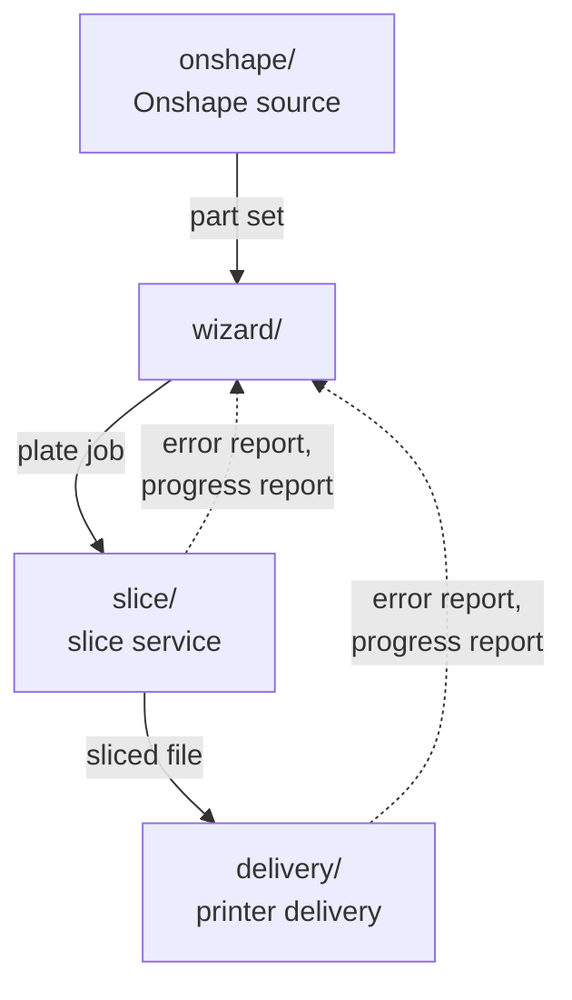

# Penguin Slicer: restart plan

Written Thu 2026-11-19, Pacific time, from a planning session with the owner. It replaces
the order of work in the
[print path restart notes](../handoffs/2026-10-11-print-path-restart-notes.md) (their
sections 6 and 8) and the milestones of the
[print roadmap](2026-10-09-print-roadmap.md). Those two files remain the record of what
was built and of the owner's feedback.

## 1. Short answer

Section 2 defines the terms. The one to know first: the **print branch** is
`feature/onshape-test-bed` in PenguinCAM, which holds all the 3D printing code written so
far.

- **The 3D printing work leaves PenguinCAM for now.** It moves to one new repository,
  Penguin Slicer, built on PenguinCAM's stack so that it can return to PenguinCAM later.
- **The repository holds four components that are developed as separate projects:** the
  slice service, printer delivery, the wizard and the Onshape source. Each one runs and is
  tested without the other three.
- **Three pieces of work are planned, and nothing beyond them:**
  1. port the slice service from the print branch and harden it;
  2. port printer delivery from the print branch and harden it;
  3. finish a mockup of the wizard for the owner to try (a first draft is being built as
     this is written; section 8 has its status).
- **Hardening means the same six things for both services, plus a short list of changes
  particular to each (sections 6.2 and 7.2). The six:** errors that say what
  happened and what to do, real progress, cancellation, cleanup when a client goes
  away, logs complete enough to support a team from the server alone, and a routine way
  to take new versions of the open-source code each service rests on.
- **The wizard is the big unknown.** Its requirements come from the owner's reactions to
  the mockup. Nothing of the wizard is built before that.
- **Planning stops there on purpose.** When the two services are solid and the owner has
  tried the mockup, the next plan is made from what was learned.

## 2. Terms

Each term means one thing everywhere in this plan.

| Term | Meaning |
|---|---|
| **Orca** | Orca Slicer, the open-source slicer that turns models into printer instructions. It runs on the server with no window. |
| **print branch** | The branch `feature/onshape-test-bed` in `6238/PenguinCAM`, which holds all 3D printing code written so far. |
| **Penguin Slicer** | The new repository and the product in it. |
| **slice service** | The component that takes a plate job, runs Orca and returns a sliced file. |
| **printer delivery** | The component that sends a sliced file to a printer and reports how the print goes. It has two halves, the relay and the daemon. |
| **relay** | The half of printer delivery that runs on the server: it holds jobs for the daemon and the printer's last status. |
| **daemon** | The half of printer delivery that runs on a small computer in the shop, next to the printer. It connects outward to the relay and talks to the printer on the local network. |
| **wizard** | The step-by-step user interface (Setup step, Parts step, Layout step, Preview step), designed for Onshape's right panel, about 320 px wide. |
| **Onshape source** | The component that turns a student's selection in Onshape into a part set. |
| **part set** | The models to print: one STL file per part, each with a name and a quantity. |
| **plate job** | A complete request to slice: the parts, where each copy sits on the plate and how it is turned, and the chosen profiles and settings. |
| **plate file** | The 3MF model file the slice service builds from a plate job and hands to Orca, with every copy already in its place. |
| **reference plates** | A chosen set of plates the team wants to be able to print. They define how large a plate the slice service must handle. |
| **delivery job** | One sliced file on its way to one printer, from the moment it is sent until the print ends. |
| **pairing code** | The code a daemon shows when it is set up. A team enters it in its configuration, and it tells the relay which daemon, and so which printer, belongs to that team. |
| **team configuration** | The settings file each team keeps in its Onshape account, which PenguinCAM reads at sign-in. |
| **sliced file** | The `.gcode.3mf` file Orca writes, which the printer runs. |
| **error report** | The one shape in which every component reports a failure (section 5.1). |
| **progress report** | The one shape in which every component reports how far a long job has got (section 5.2). |
| **port** | Copy code and its tests from the print branch into Penguin Slicer and make them pass there, without changing behaviour. |
| **hardening** | Bringing a ported component up to the standing requirements of section 5, plus the changes listed for that component in section 6.2 or 7.2. |
| **profile** | One of Orca's named bundles of settings for a printer, a filament or a printing process. The profile catalog is the set of them the slice service offers. |
| **plate limits** | The caps on what one plate may hold: distinct parts, copies, triangles per part, and the plate triangle cap. |
| **plate triangle cap** | The one plate limit that counts triangles summed over every copy on the plate (300,000). |
| **local mode** | A way of running the print branch with no Onshape: a stand-in page where STL files are dropped in, around the real user interface. The owner tried the print branch through it on Sun 10-11. |
| **validation run** | The one recorded session against real Onshape, with the owner, that the restart notes planned in order to confirm the Onshape behaviour the print branch only guesses at. |
| **simulated printer** | A program that answers the daemon as a printer would, replaying status documents recorded from the team's H2S printer. It does not exist yet. |
| **printer stand-in** | The small fake printer object the daemon's existing tests use. It returns fixed answers and replays nothing. |
| **mockup** | A click-through imitation of the wizard that runs entirely in the browser, with no server and no real slicing. |

## 3. Why the plan changed

The print branch grew to 412 changed files against `main` (counted on Thu 11-19 from the
point where the branch left `main`; the restart notes' 345 was an earlier count). About 9,000 lines of that are
program code and 6,000 are tests; most of the rest is Orca's profile data. The parts of it
that turn a plate into a sliced file and send it to a printer work: Orca slices on the
server, and the team's H2S printed a part through the relay on Fri 10-09.

The user interface is where it went wrong. It was built before its requirements were
known, and when the owner tried it in local mode on Sun 10-11 the capabilities that matter were missing:
a Layout step in 3D with direct manipulation, a preview like Orca's, real progress, and
errors a student can act on. The feedback from that day is quoted in the
[print path restart notes](../handoffs/2026-10-11-print-path-restart-notes.md), section 6.

Three conclusions from the planning session shape this plan:

1. **The four components are largely independent.** The wizard produces a plate job
   without ever running Orca. The slice service needs nothing from Onshape. Printer
   delivery needs only a sliced file. So each can be built and proven alone.
2. **Three of the four are mostly solved.** The slice service and printer delivery need
   porting and hardening, not invention, and both are in this plan. The Onshape source is
   also a solved problem: PenguinCAM's CNC wizard already runs in Onshape's panel, in
   production, and gathers several selected parts into one job. The print branch already
   holds the printing version of that code (selecting parts in a Part Studio or an
   Assembly and exporting each as an STL file); it has never run against real Onshape.

   The restart notes ranked the validation run as the riskiest item. That ranking is
   withdrawn, for two reasons. First, the mechanism the print branch was thought to be
   guessing at, a selection request that stays armed while parts are clicked, is the one
   the CNC wizard uses in production. Second, most of the stated risk belonged to the
   automated recording of Onshape sessions, not to the Onshape source: signing in by
   script, a bot check that can stop it, and a yearly budget of 250 counted calls. What
   stays unverified until the Onshape source is taken up is small: the answer Onshape
   gives when whole bodies are selected where CNC selects faces, the STL export where CNC
   exports a drawing, and picking parts inside an assembly. Those are checked by hand in
   Onshape at that point (section 9).
3. **The risk is in the wizard's requirements,** so that is where the owner's attention
   goes first, through a mockup, while the two services are made solid.

## 4. The repository

One repository, never several. Each component has its own folder, its own tests, its own
guide and a way to run it alone from the command line.

| Folder | Holds | In this plan |
|---|---|---|
| `contracts/` | The definitions of the part set, plate job, sliced file, error report and progress report, each with example files | Written with the slice service |
| `slice/` | The slice service: the code that runs Orca, the profile catalog, the writer of the plate file, the job queue, its tests and its scripts | Ported and hardened |
| `delivery/` | Printer delivery: `relay/`, `daemon/` and the simulated printer | Ported and hardened |
| `wizard/` | The wizard | Empty; the mockup stays in the notes repository until the wizard's requirements exist |
| `onshape/` | The Onshape source | Empty |

Rules that keep the components separate:

- A component depends only on `contracts/`, never on another component's code.
- A component can be exercised from the command line with example files from
  `contracts/`: slice this plate job; deliver this sliced file to the simulated printer.
- In production the components may run inside one server and call each other directly.
  The files in `contracts/` are seams for development and testing, not a deployment.
- Code is ported by copying files, with a commit message naming the print branch commit
  they came from. The print branch stays as it is, as the record.

The stack is PenguinCAM's: Python managed with `uv`, Flask where a component needs HTTP,
plain JavaScript in the browser.

## 5. Standing requirements

These hold for the slice service and for printer delivery, and later for every other
component. A component is not done until each is shown by a test. The owner's reason: the
quality of real software is decided by how it handles the unusual case.

### 5.1 Errors

Every failure is an error report with five parts:

- a stable code, so support and tests can name it;
- what happened, in a sentence a student understands;
- where: the part, the copy and the height or step, when that is known;
- what to do next, and which single action fixes it when one does;
- the underlying detail (Orca's own words, the printer's status), kept for the server log
  and never thrown away.

Each error report has a test that produces it on purpose.

### 5.2 Progress

Every job that can take more than a few seconds sends progress reports from start to
finish: the stage it is in, how far through it is when that can be known, the time taken
so far and the time expected. A client that connects late gets the current progress
report at once.

### 5.3 Cancellation

Every long job can be cancelled at any moment. Cancelling stops the work itself (the Orca
process, the upload), not only the reporting of it, and ends in a state from which the
same job can be started again.

### 5.4 Cleanup

When a client goes away without cancelling, the component notices, waits a stated time in
case the client returns, then stops the work and removes its files. Nothing is left
running and nothing accumulates on disk. A restart of the component leaves no job in an
unknown state.

### 5.5 Supportable from the server

Every transition of a job writes one log line with enough in it to diagnose a failure
without asking the team for anything. No secret appears in a log.

### 5.6 Upstream code

Both services rest on open-source code written by others: the slice service on Orca and
its profiles, the daemon on a library that speaks the printer's protocol. Two rules,
added by the owner on Thu 11-19:

- **Taking a new version is routine.** Each one's version is pinned in one place, one
  command moves the pin and regenerates what is derived from it, and a named suite of
  tests pins down every behaviour of that code the service relies on, so a new version
  that breaks an assumption fails a test that says which.
- **Small patches are allowed** where that code reports an error or progress too poorly
  to meet sections 5.1 and 5.2, never for a new feature. A patch is kept as a file
  against a named version, with a note saying what gap it closes, and the upgrade command
  applies it. Patching Orca means building it from source, so each such patch is the
  owner's decision.

## 6. Work 1: the slice service

### 6.1 Port

What comes over from the print branch: the code that runs Orca, the profile catalog and
the script that builds it from Orca's own profiles, the writer of the plate file, the
placement checks, the limits, the job queue, the Orca installer script, the measurement
script and their tests.

One dependency is cut during the port. The print branch reads the chosen profiles from
PenguinCAM's team configuration; in Penguin Slicer the plate job names its profiles and
settings outright, so the slice service knows nothing of teams or Onshape.

The port is done when the ported tests pass in the new repository and one command slices
an example plate job from `contracts/` into a sliced file.

### 6.2 Hardening

| Standing requirement | State on the print branch | What hardening adds |
|---|---|---|
| Errors | Orca's general failure code is shown as "A part has no flat face on the plate", which is wrong. Orca's real reason is in a file that is deleted on failure. | Orca's reason is read before the files are removed and becomes an error report. Every Orca failure code, every plate limit and the slice timeout has its own error report and a model file that triggers it. |
| Progress | The service waits for Orca to exit and says only "still running" every 5 seconds. | Orca's output is read while it runs. Whether Orca without a window reports its stages is **not yet verified**; if it does not, progress is an estimate from the plate's size. |
| Cancellation | None. A slice runs to its end or to the 240 second slice timeout, and until then it holds the single slot the print branch has for running Orca, so every other slice waits. | A cancel call stops Orca and frees the slot. |
| Cleanup | Closing the browser stops nothing. | Section 5.4. |
| Supportable from the server | A failed slice logs its failure code but not Orca's reason, the settings or which copies were on the plate. | Section 5.5: each log line carries those. |

Two further changes belong to hardening the slice service:

- **A check of each part's mesh when it arrives.** Every failed slice on Sun 10-11 came
  from one part whose mesh had gaps. The check names such a part before any slicing.
- **Plate limits that measure the right thing.** Measurements on Sun 10-11 showed that
  Orca's peak memory for one slice follows the volume of the parts, not triangles. So the
  plate triangle cap refuses harmless plates and admits ones that peak at 1.7 to 2.3 GB,
  against the 900 MB the print branch set as the most one slice may use. The plate
  triangle cap is replaced by a cap on estimated memory, fitted to measurements of the
  reference plates. Its ceiling is a setting, 900 MB by default; the hosting choice, which
  is outside this plan, changes it later. The other plate limits stay.

The measurements are in the
[local mode errors and limits research](../research/2026-10-11-local-mode-errors-and-limits.md).

## 7. Work 2: printer delivery

### 7.1 Port

What comes over: the relay, the daemon, the way a daemon is paired with a team through its
pairing code, the protocol by which the daemon fetches delivery jobs, and their tests. The daemon stays in Python in this plan (decision 2 in section 10).

The relay on the print branch reads a team's pairing code from the team configuration. As with the slice service, that dependency is cut: the relay is given the
pairing code by whoever calls it.

The port is done when the ported tests pass and the relay and the daemon run together on
one machine, with the printer played by the printer stand-in.
Delivering to the simulated printer comes with hardening.

### 7.2 Hardening

The first test on the H2S, on Fri 10-09, printed a part and found the faults below. It ran
on the branch `feature/printer-relay`, whose code is now on the print branch with none of
the faults fixed. They are described in full in the
[first hardware test notes](../handoffs/2026-10-09-printer-relay-first-hardware-test.md).

| Standing requirement | State on the print branch | What hardening adds |
|---|---|---|
| Errors | The daemon reported the delivery job as failed while the part printed, because it looks for the file's name in a field where the H2S never puts it. The upload logs a failure when it succeeds, and a real upload failure would go unnoticed. | Both faults fixed. An error report for each real failure: printer busy, printer unreachable, upload failed, print not started, print failed partway. |
| Progress | One status line, polled every 5 seconds, which showed nothing during the test. | Progress reports through the whole delivery: sent to the daemon, uploading, starting, then the print itself with its stage, percent, layer of total and minutes remaining, which the H2S reports. |
| Cancellation | None. | A delivery job can be cancelled until the printer starts the file. Stopping a print that is already running is outside this plan. |
| Cleanup | The records of delivery jobs expire; behaviour after a daemon restart rests on the faulty name check. | Section 5.4, and a restarted daemon never starts the same file twice. |
| Supportable from the server | The relay logs no request lines; during the test nobody could tell whether status was still being asked for. | Section 5.5: every step of a delivery job and every exchange with the daemon is logged. |

Hardening printer delivery also builds the simulated printer, so that every row above is
tested without the printer and without the owner in the shop. **It needs recordings that
do not exist yet.** The first hardware test saved one status document, taken at 0 percent,
and it is in the owner's home directory on the Mac (`~/h2s_status_printing.json`), not in
any repository. The simulated printer needs the whole sequence of status documents of one
print from start to finish, and of a failed or stopped print if one can be had. Recording
them takes one session at the H2S with the daemon as it is. Until then the simulated
printer can be built against that one document and invented sequences, which is weaker.

One confirmation on the real H2S closes this work, after everything passes against the
simulated printer.

## 8. Work 3: the wizard mockup

The mockup lets the owner go through the whole wizard, at panel width, before any of it is
built. It shows the four steps in the conventions of PenguinCAM's CNC wizard, the
capabilities the owner asked for on Sun 10-11, mocked progress for slicing and printing,
and a set of errors that can be triggered on purpose.

Status when this was written: a first draft is being built in
[mockups/print-wizard](../mockups/print-wizard/index.html) in this repository. It is then
reviewed and improved in several rounds before the owner is asked to try it. A list of
every design choice the mockup makes will sit beside it as `DECISIONS.md`.

The owner's direction for it: keep the CNC wizard's conventions unless additive
manufacturing is distinctly different; make the common case short, since most prints use
one filament and one of a few profiles; keep every slicing setting reachable; bring over
capabilities from the two main views of Orca's desktop application: its Prepare tab, where
parts are arranged on the plate, and its Preview tab, where the sliced result is inspected
layer by layer.

The mockup is thrown away afterwards. What it produces is the owner's reactions, written
up as the wizard's requirements. That document is the input to the next plan.

## 9. What is not in this plan

| Item | Why it waits |
|---|---|
| Building the wizard | Its requirements come from the mockup. |
| The Onshape source, and with it the checks against real Onshape | It feeds the wizard's Parts step. When the wizard exists, it is ported from the print branch and brought into line with PenguinCAM's CNC integration. |
| Local mode | It stays on the print branch. The owner wanted a way to use printing without Onshape kept; in Penguin Slicer that is the wizard's own file upload, once the wizard is built. Until then each service is run from the command line (section 4). |
| Daemon telemetry | Open decision 3. |
| Returning to PenguinCAM | It follows a working whole. |
| Choosing the hosting | It follows the memory measurements in section 6.2. |
| Rebuilding the daemon as one executable, printer adapters for other brands, the preview image on the printer's screen, file names that say which part and when | Each is new design, recorded in the [first hardware test notes](../handoffs/2026-10-09-printer-relay-first-hardware-test.md). Decision 2 covers the first. |
| The Onshape test bed on the print branch (recorded and replayed Onshape sessions) | It serves the Onshape source and stays on the print branch until that is planned. |

## 10. Open decisions for the owner

1. **The repository's name, owner and visibility.** A proposal: `penguin-slicer`, under
   the owner's own account while it is being built, since the team's account is where
   reviewed work goes. The owner creates it and adds it to the workspace.
2. **Decided Thu 11-19: the daemon stays in Python for now.** The owner: bring it up on
   Python, get everything working, and port it later to a technology that makes one
   lightweight executable, most likely Rust or Go. The simulated printer and the tests
   built here are what that later port is checked against.
3. **Daemon telemetry.** On Fri 10-09 the owner named this the most important lesson of
   the test: the daemon reports its own state to the server from the moment it starts, so
   a mentor's broken setup can be diagnosed remotely. Is it part of hardening printer
   delivery, or its own later work? This plan leaves it out; section 5.5 covers only log
   lines for jobs.
4. **Where Penguin Slicer's specs and plans live.** PenguinCAM keeps them out of its
   tree, in this notes repository. Penguin Slicer could keep them in its own `docs/`,
   beside the component they describe.
5. **Which plates are the reference plates** for the plate limits in section 6.2. The
   restart notes propose a set; the owner has not confirmed it.
6. **A recording session at the H2S** for the simulated printer (section 7.2): whether and
   when the owner can run one print with the daemon recording every status document.
